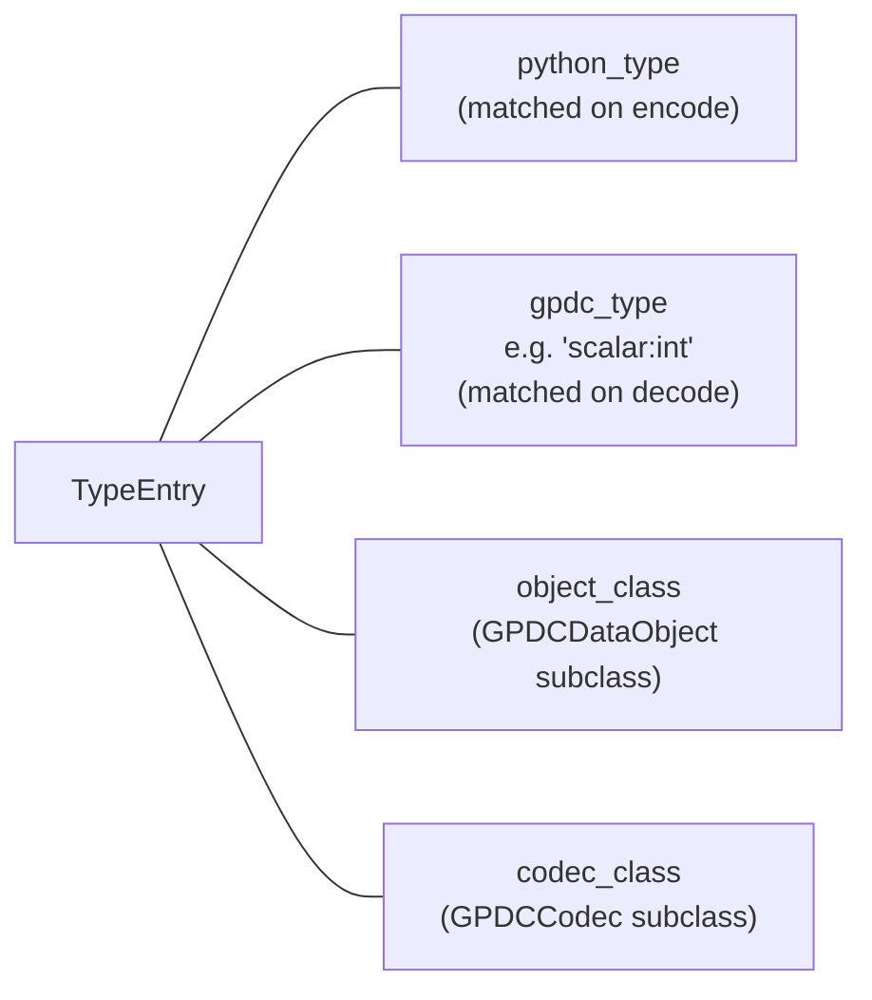
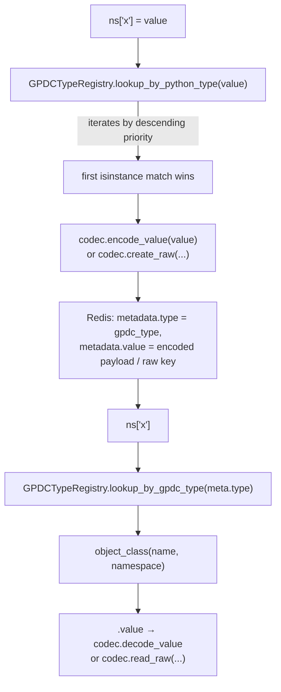
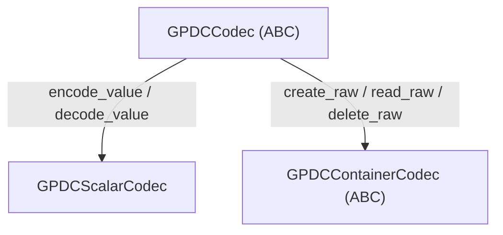
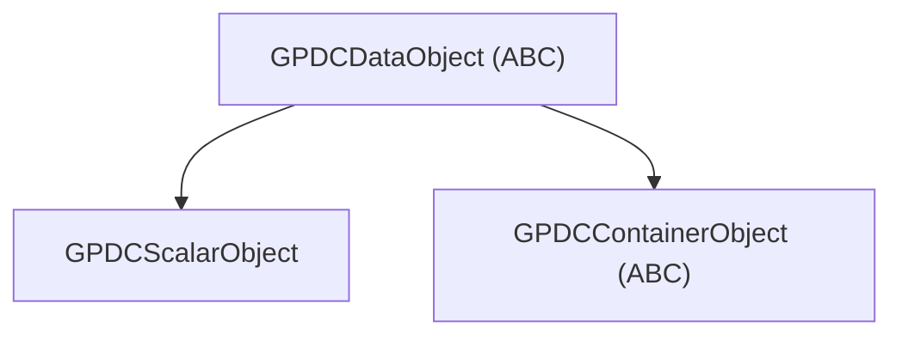

# Extensibility

This document explains how `gpdatacached`'s type system works and how to add support for **your own types** — both scalar and container — by writing a codec, an object class, and registering them. The built-in scalar types (`int`, `str`, …), container types (`list`, `dict`, `set`), and the optional extensions (pydantic, pandas) are all built on exactly the same public mechanism described here.
> **Do you need to read this?** For the large majority of users and use cases, GPDC's built-in types — together with the bundled [Pydantic](./pydantic-support.md) and [Pandas](./pandas-support.md) extensions — are already enough. If you do need a custom type, a **scalar** type or a **flat (non-nested) container** type will cover most real-world extension needs, and both are relatively straightforward to write. Reach for the full machinery described here only when you are extending a genuinely complex type (something on the order of `pandas.Series` / `pandas.DataFrame`). In that case, read this document carefully **and** study the [Lifecycle](./lifecycle.md), [Locking](./locking.md), and [Performance Guide](./performance-guide.md) documents as well — getting a complex type right requires a fairly complete mental model of GPDC; otherwise it is easy to introduce subtle bugs.

---

## 1. The Type System at a Glance

Every Python value that GPDC stores is described by a **`TypeEntry`** — an immutable record linking four things:



All entries live in one global, thread-safe registry: **`GPDCTypeRegistry`**. Both lookups go through it:

- **Encoding** (`ns["x"] = value`) → `lookup_by_python_type(value)` finds the entry whose `python_type` matches `value`.
- **Decoding** (reading back) → the stored GPDC type string selects the entry via `lookup_by_gpdc_type`.

Two value families exist, with different contracts:

| Family | Stored as | Codec base | Object base | Examples |
|---|---|---|---|---|
| **Scalar** | A single encoded string inside the object's metadata hash | `GPDCScalarCodec` | `GPDCScalarObject` | `int`, `str`, `datetime`, `tuple`, `None` |
| **Container** | Element data in a dedicated Redis key (`raw:`) | `GPDCContainerCodec` | `GPDCContainerObject` | `list`, `dict`, `set` |

> Note: `tuple` is registered as a **scalar** (a "composite scalar" stored as one JSON string), not as a container. Whether something is a scalar or a container is a design choice you make when registering — see [§4](#4-the-codec-contract).

---

## 2. The Registration Triple

Registering a type always means pairing four things via one call:

```python
from gpdatacached import GPDCTypeRegistry

GPDCTypeRegistry.register(
    python_type=MyType,                 # the Python class(es) this entry matches
    gpdc_type="scalar:mytype",          # unique GPDC type string (a "family:name" pair)
    object_class=MyObject,              # GPDCScalarObject / GPDCContainerObject subclass
    codec_class=MyCodec,                # GPDCScalarCodec / GPDCContainerCodec subclass
    priority=0,                         # tiebreaker for ambiguous Python types (higher wins)
)
```

The four fields map directly onto a `TypeEntry`. Two invariants matter:

1. **`object_class.TYPE` must equal `gpdc_type`.** The object class identifies itself by its `TYPE` class attribute, and several internal paths (especially decoding) cross-check the two.
2. **`gpdc_type` must be globally unique.** Re-registering the same `gpdc_type` replaces the previous entry (idempotent-style), but two different Python types must not share one `gpdc_type`.

The `TypeEntry` also exposes a derived boolean `is_container` (true when `object_class` is a subclass of `GPDCContainerObject`); the codec/object bases you pick determine it.

---

## 3. Type Resolution: encode vs decode



### The priority rule

The registry iterates entries **sorted by descending `priority`** and returns the first one whose `python_type` matches `value` via `isinstance`. This matters whenever your custom type **subclasses a type that is already registered**. The built-ins rely on it: `bool` is registered at `priority=10` and `int` at `priority=0`, so a `True` value matches `bool` first (otherwise it would be misrouted to `int`, since `bool` subclasses `int`). See [§8](#extend-priority).

---

## 4. The Codec Contract

Three abstract base classes form the codec hierarchy:



### `GPDCCodec` — the root ABC

```python
class GPDCCodec(ABC):
    @classmethod
    @abstractmethod
    def encode_value(cls, value: object) -> str: ...
    @classmethod
    @abstractmethod
    def decode_value(cls, encoded: str) -> object: ...
```

You never subclass this directly — pick one of the two specialised bases below.

### `GPDCScalarCodec` — for scalars

```python
class GPDCScalarCodec(GPDCCodec):
    @classmethod
    def _parse_encoded(cls, encoded: str) -> tuple[str, str]:
        # Split "type_prefix:payload" → (prefix, payload). Raises ValueError if malformed.
        ...
```

A scalar codec implements `encode_value` / `decode_value`. The convention is that the encoded form starts with a **type prefix** followed by a colon: `"int:42"`, `"str:hello"`, `"color:10,20,30"`. The shared `_parse_encoded` helper splits this for you on decode.

The encoded string lives **directly in the object's metadata hash** under the `value` field. No raw key is used.

### `GPDCContainerCodec` — for containers

```python
class GPDCContainerCodec(ABC):
    @classmethod
    @abstractmethod
    def create_raw(cls, namespace, raw_key: str, value: object,
                   owner_name: str, cache_mode: str, ttl: int) -> None: ...
    @classmethod
    @abstractmethod
    def read_raw(cls, namespace, raw_key: str) -> object: ...
    @classmethod
    @abstractmethod
    def delete_raw(cls, namespace, raw_key: str) -> None: ...
```

A container codec does **not** use `encode_value`/`decode_value`. Instead it owns a dedicated Redis key (`raw_key`) and knows how to lay the value out in Redis and reconstruct it:

| Method | When called | Your job |
|---|---|---|
| `create_raw(namespace, raw_key, value, owner_name, cache_mode, ttl)` | On first store / full overwrite | Write `value`'s elements into `raw_key` (LIST/HASH/SET/…). Use the encode helpers for elements. |
| `read_raw(namespace, raw_key) -> object` | On `.value` reads | Reconstruct and return a plain Python object from Redis. |
| `delete_raw(namespace, raw_key)` | Before re-creating, and on teardown | Delete the raw key. |

The `namespace` argument gives you `namespace._redis()` (the Redis client) and `namespace.domain.name` / `namespace.name` for key construction. `owner_name`, `cache_mode`, `ttl` are forwarded so that nested-element encoding (see [§10](#10-element-encoding-scalar-members-vs-nested-containers)) can apply the right policy.

---

## 5. The Object Class Contract

Object classes are thin wrappers that bind a Redis key to a Python-facing API. Three ABCs again:



### `GPDCDataObject` — the root ABC

Provides identity (`name`, `namespace`, `domain`, `uri`, `canonical_name`), metadata access (`meta`, `cache_mode`, `ttl`, `created_at`, `updated_at`), lifecycle methods (`expire_in`, `persist`, …), and locking (`lock()`, `try_lock()`). You inherit all of this for free.

### `GPDCScalarObject` — for scalars

Subclasses set one class attribute and inherit the value getter/setter:

```python
class MyObject(GPDCScalarObject):
    TYPE = "scalar:mytype"
```

- `.value` getter loads metadata, looks up the codec via `TYPE`, and calls `decode_value`.
- `.value` setter type-checks against the registered `python_type`, encodes via `encode_value`, writes the metadata, and refreshes TTL when `cache_mode == "sliding"`.

You almost never override anything else.

### `GPDCContainerObject` — for containers

Subclasses mix in a `collections.abc` interface (`MutableSequence`, `MutableMapping`, or `MutableSet`) and implement its abstract methods on top of `self.raw_key`. You must provide:

- A `TYPE = "collection:mytype"` class attribute.
- A `type` property returning `cls.TYPE`.
- A `value` property (decode via `read_raw`) **and** a `value` setter that calls `self._reject_value_replacement()` — containers are mutated through their explicit methods, not reassigned.
- All abstract methods of the mixed-in ABC (`__getitem__`, `__setitem__`, `__delitem__`, `__len__`, `__iter__`, `insert`, …).
- A `deepcopy()` method.

You inherit `_touch()`, ref-tracking helpers (`_release_element_ref`, `_data_owner_name`, `referrers()`), and the encode/decode helpers — these are the building blocks for [§11](#extend-mutation-hooks).

!!! note "Your `__getitem__` has a second caller: URI traversal"

    [`GPDataCache.get_object_by_uri`](./api.md#get_object_by_uri) descends into a container via `__getitem__`, one path segment at a time. Two consequences for a custom container:

    - The traversal only **coerces** a segment to `int` for `ListObject`; every other container receives the raw **string** segment. If your container expects non-string keys, it is not reachable by URI path segments (the segment will arrive as a string).
    - The traversal returns **objects, never values**. If your `__getitem__` returns a native Python value (as the built-in `DictObject`/`ListObject` do for scalar elements), a URI that terminates there raises `ObjectNotFoundByURIError`. This is by design — it mirrors `__getitem__` returning native values for scalar elements.

---

## 6. The Four-Step Extension Recipe

Every extension, no matter how complex, boils down to four steps:

1. **Pick the family.** Scalar = store-one-value; container = store-elements-in-Redis.
2. **Write the codec** (`GPDCScalarCodec` or `GPDCContainerCodec`).
3. **Write the object class** (`GPDCScalarObject` or `GPDCContainerObject`), with `TYPE` matching the GPDC type you will register.
4. **Register** with `GPDCTypeRegistry.register(...)`, choosing a `priority` that beats any registered superclass.

The next sections walk through both families with complete, runnable examples.

---

## 7. Worked Example: A Custom Scalar Type (`Color`)

Goal: cache an RGB `Color` value. It is a small, immutable, atomic value — a perfect fit for **scalar mode**.

### Step 1 — the Python type

```python
from dataclasses import dataclass

@dataclass(frozen=True)
class Color:
    r: int
    g: int
    b: int
```

### Step 2 — the codec

A scalar codec encodes to a `prefix:payload` string and decodes back. The prefix must match the part of the GPDC type after `scalar:`.

```python
from gpdatacached import GPDCScalarCodec

class ColorCodec(GPDCScalarCodec):
    @classmethod
    def encode_value(cls, value: object) -> str:
        # Always validate the input type explicitly — don't rely on duck typing.
        if not isinstance(value, Color):
            raise TypeError(f"ColorCodec cannot encode {type(value).__name__!r}")
        # Convention: "prefix:payload". Keep the payload Redis-hash-safe (no stray colons
        # that would confuse _parse_encoded, which splits on the FIRST colon).
        return f"color:{value.r},{value.g},{value.b}"

    @classmethod
    def decode_value(cls, encoded: str) -> object:
        # _parse_encoded returns (prefix, payload) and raises ValueError on malformed input.
        prefix, payload = cls._parse_encoded(encoded)
        if prefix != "color":
            raise ValueError(f"ColorCodec cannot decode type {prefix!r}")
        try:
            r, g, b = (int(x) for x in payload.split(","))
        except ValueError as e:
            raise ValueError(f"Invalid color payload: {payload!r}") from e
        return Color(r, g, b)
```

Two things to notice:

- **Explicit type check on encode.** The codec may be called with anything; rejecting early gives clear errors.
- **`_parse_encoded` splits on the first colon.** If your payload contains colons (e.g. an ISO datetime), that is fine — only the first colon is split.

### Step 3 — the object class

For scalars, this is a one-liner:

```python
from gpdatacached import GPDCScalarObject

class ColorObject(GPDCScalarObject):
    TYPE = "scalar:color"   # MUST match the gpdc_type you register
```

### Step 4 — register and use

```python
from gpdatacached import GPDCTypeRegistry, GPDCDomain, GPDCDomainConfig

GPDCTypeRegistry.register(
    python_type=Color,
    gpdc_type="scalar:color",
    object_class=ColorObject,
    codec_class=ColorCodec,
    priority=0,
)

domain = GPDCDomain(GPDCDomainConfig(redis_host="127.0.0.1", redis_port=6379), name="app")
ns = domain.ensure_namespace("ui")

ns["background"] = Color(10, 20, 30)
assert ns["background"] == Color(10, 20, 30)   # reads back as a native Color

# It composes with everything else for free.
ns["palette"] = [Color(255, 0, 0), Color(0, 255, 0)]   # nested in a list
ns["theme"] = {"bg": Color(0, 0, 0)}                   # nested in a dict
ns.get_object("background").update_cache_mode_and_ttl("ttl", 60)  # lifecycle works
```

The codec is also invoked automatically when your type appears as a list/dict element or a tuple member — you do not need to teach the containers about `Color`.

---

## 8. Priority in Practice: Subclass Relationships { #extend-priority }

The registry matches via `isinstance`, sorted by descending `priority`. This is **critical** whenever your type subclasses an already-registered type.

```python
import enum

class Status(enum.IntEnum):
    ACTIVE = 1
    INACTIVE = 2
    DISABLED = 3
```

`Status` subclasses `int`, and `int` is already registered at `priority=0`. If you register `Status` at `priority=0` too, the registry order is unstable and a `Status.ACTIVE` value may match the plain `int` entry first — getting stored as `"int:1"` and losing the enum. The fix is to register at a higher priority:

```python
GPDCTypeRegistry.register(
    python_type=Status,
    gpdc_type="scalar:status",
    object_class=StatusObject,
    codec_class=StatusCodec,
    priority=10,          # beats int (priority 0) — checked first
)
```

**Rule of thumb:** if your type `isinstance(x, SomeRegisteredType)` is `True`, give yours a higher `priority` than that type.

---

## 9. Worked Example: A Custom Container Type (`Counter`)

Goal: cache a `collections.Counter` (a multiset). This is a **container** — it has a variable number of members and we want to mutate it in place. We will back it with a Redis HASH: `{encoded_member: count_string}`.

### Step 1 — the Python type

```python
from collections import Counter
```

`Counter` is a `dict` subclass — so we will need `priority > 0` to be matched before `dict` (see [§8](#extend-priority)).

### Step 2 — the codec

```python
from gpdatacached import GPDCContainerCodec
from gpdatacached.types import encode_key, decode_key

class CounterCodec(GPDCContainerCodec):
    """Stores a Counter as a Redis HASH mapping encoded_member → count string."""

    @classmethod
    def create_raw(cls, namespace, raw_key, value, owner_name, cache_mode, ttl) -> None:
        if not value:
            return
        # Members are hashable scalars — encode_key normalises each to its
        # "prefix:payload" form so the hash field names are unambiguous.
        mapping = {encode_key(member): str(count) for member, count in value.items()}
        namespace._redis().hset(raw_key, mapping=mapping)

    @classmethod
    def read_raw(cls, namespace, raw_key) -> Counter:
        data = namespace._redis().hgetall(raw_key)
        if not data:
            return Counter()
        return Counter({decode_key(k): int(v) for k, v in data.items()})

    @classmethod
    def delete_raw(cls, namespace, raw_key) -> None:
        namespace._redis().delete(raw_key)
```

Notes:

- Members are **scalars**, so we use `encode_key` / `decode_key` (the key-encoding helpers). For elements that might themselves be containers, you would use `encode_element` / `decode_element` instead — see [§10](#10-element-encoding-scalar-members-vs-nested-containers).
- Counts are stored as plain decimal strings. They are scalars, but we encode them inline rather than registering `int`-as-count, because the count's meaning is local to this container.
- `create_raw` is a no-op when `value` is empty — GPDC leaves the raw key absent, and `read_raw` returns an empty `Counter`.

### Step 3 — the object class

We mix in `MutableMapping` so users get `keys()`, `values()`, `items()`, `get()`, `setdefault()`, `update()`, and `pop()` for free. We implement the four abstract methods directly on `self.raw_key`.

```python
import collections.abc
from collections import Counter
from gpdatacached import GPDCContainerObject
from gpdatacached.types import encode_key, decode_key

class CounterObject(GPDCContainerObject, collections.abc.MutableMapping):
    TYPE = "collection:counter"

    @property
    def type(self) -> str:
        return self.TYPE

    @property
    def value(self) -> Counter:
        return CounterCodec.read_raw(self._namespace, self.raw_key)

    @value.setter
    def value(self, new_value):
        # Containers cannot be reassigned — mutate via __setitem__ etc. instead.
        self._reject_value_replacement()

    def __len__(self) -> int:
        return self._redis().hlen(self.raw_key)

    def __getitem__(self, key):
        encoded = encode_key(key)
        raw = self._redis().hget(self.raw_key, encoded)
        if raw is None:
            raise KeyError(key)
        return int(raw)

    def __setitem__(self, key, count):
        if not isinstance(count, int) or count < 0:
            raise ValueError("Counter values must be non-negative ints")
        encoded = encode_key(key)
        r = self._redis()
        if count == 0:
            r.hdel(self.raw_key, encoded)
        else:
            r.hset(self.raw_key, encoded, str(count))
        self._touch()                  # refresh sliding TTL + updated_at (see §11)

    def __delitem__(self, key):
        encoded = encode_key(key)
        if not self._redis().hdel(self.raw_key, encoded):
            raise KeyError(key)
        self._touch()

    def __iter__(self):
        for encoded in self._redis().hkeys(self.raw_key):
            yield decode_key(encoded)

    def deepcopy(self) -> Counter:
        return Counter(self.value)
```

### Step 4 — register and use

```python
from gpdatacached import GPDCTypeRegistry, GPDCDomain, GPDCDomainConfig

GPDCTypeRegistry.register(
    python_type=Counter,
    gpdc_type="collection:counter",
    object_class=CounterObject,
    codec_class=CounterCodec,
    priority=10,          # Counter subclasses dict → must outrank dict (priority 0)
)

domain = GPDCDomain(GPDCDomainConfig(redis_host="127.0.0.1", redis_port=6379), name="counterapp")
ns = domain.ensure_namespace("words")

ns["word_counts"] = Counter({"hello": 3, "world": 1})
counts = ns["word_counts"]            # → CounterObject (live)
counts["hello"] += 1                  # mutate in place, hits Redis directly
assert counts["hello"] == 4
del counts["world"]
assert "world" not in counts
```

Because we mixed in `MutableMapping`, you also get `counts.update(...)`, `counts.get(k, default)`, `counts.pop(k)`, and `counts.most_common()` (the last comes from `Counter` once you materialise via `.value`).

---

## 10. Element Encoding: Scalar Members vs Nested Containers

The `Counter` example uses `encode_key` / `decode_key` because its members are **hashable scalars**. If your container can hold **nested containers** as elements (like the built-in `list` / `dict`), you must instead use `encode_element` / `decode_element`, which emit a `ref:{obj_key}` pointer for any container value and lazily materialise it as an anonymous GPDC object.

| Helper | When to use | Output |
|---|---|---|
| `encode_key(value)` / `decode_key(encoded)` | Hashable scalar elements (dict keys, set members, our Counter's members) | Always a `prefix:payload` string; rejects containers and the empty tuple |
| `encode_element(value, namespace, owner_name, policy)` / `decode_element(encoded, namespace)` | Elements that may be **either** scalar **or** container | A scalar-encoded string, **or** a `ref:{obj_key}` pointer that resolves to a live `GPDCContainerObject` |

For example, the built-in `DictCodec` uses `encode_key` for keys (always scalar) but `encode_element` for values (may be a nested list/dict/set). The built-in `ListCodec` uses `encode_element` for every element. When you remove or overwrite an element that turned out to be a `ref:` pointer, you must call `self._release_element_ref(old_encoded)` so the anonymous child's referrer count is decremented (and the child cascade-deleted when its last referrer goes) — see [§11](#extend-mutation-hooks).

When `create_raw` encodes **multiple sibling elements in one call**, wrap the encode loop in an **`encode_session`** context manager. It provides cycle detection and rollback so that a failure mid-encode deletes every anonymous object created during the call and reverses any ref-count increments it made on pre-existing containers — the encode path's writes are reverted. (Note: `encode_session` only governs the encode path. If your `create_raw` does any **pre-encode** writes — e.g. the pandas RangeIndex→levels index-representation promotion committed before the append pipeline — those are not covered by the session and stay committed on failure. Keep pre-encode writes out of the session, or accept that a failed append may leave a representation-only change behind.)

```python
from gpdatacached.types import encode_element, encode_session

@classmethod
def create_raw(cls, namespace, raw_key, value, owner_name, cache_mode, ttl):
    from gpdatacached.lifecycle import policy_from_defaults
    policy = policy_from_defaults(cache_mode, ttl)
    encoded_values = []
    with encode_session(namespace):           # cycle detection + rollback
        encoded_values = [encode_element(v, namespace, owner_name, policy) for v in value]
    if encoded_values:
        namespace._redis().rpush(raw_key, *encoded_values)
```

> For full reference, study `src/gpdatacached/builtins/list_object.py` and `dict_object.py` — they show the complete encode/decode/release pattern for nested-container containers.

> ⚠️ **Performance note.** Each nested container becomes its own anonymous object with its own keys, ref tracking, and TTL. Deep nesting compounds this cost on store, read, sliding refresh, and cascade delete. See [Performance Guide §4](./performance-guide.md#perf-nesting) for guidance on when to flatten.

---

## 11. Mutation Hooks Every Container Must Call { #extend-mutation-hooks }

When you implement a container object, every method that mutates Redis must honour three hooks. Skipping any of them produces subtle bugs (stale TTL, leaked anonymous children, wrong update timestamps).

### a) Call `self._touch()` after every mutation

`_touch()` (defined on `GPDCContainerObject`) updates the `updated_at` and `item_count` metadata, and — if the object is self-owned and in `sliding` mode — refreshes the TTL across the owned subtree. If the object is owned by a parent, it propagates the refresh up the owner chain instead.

```python
def __setitem__(self, key, count):
    ...
    r.hset(self.raw_key, encoded, str(count))
    self._touch()          # ← always
```

### b) Call `self._release_element_ref(old_encoded)` when removing a `ref:` element

If your container supports nested container elements (via `encode_element`), removing or overwriting one must decrement the anonymous child's referrer count:

```python
def __setitem__(self, key, value):
    encoded_key = encode_key(key)
    old = r.hget(self.raw_key, encoded_key)
    encoded_val = encode_element(value, self._namespace, self._data_owner_name(), policy)
    r.hset(self.raw_key, encoded_key, encoded_val)
    self._release_element_ref(old)   # ← releases the previous value's ref, if it was a ref
    self._touch()
```

`_release_element_ref` is a no-op for non-`ref:` encoded values, so it is always safe to call.

### c) Use `encode_session` for multi-element encodes

See [§10](#10-element-encoding-scalar-members-vs-nested-containers). Single-element mutations (`append`, `__setitem__` with one value) do not need it — the encode path opens a fallback session internally.

> Read [Lifecycle Management](./lifecycle.md) for the full ownership and ref-counting model that these hooks participate in.

---

## 12. Registration Checklist & Gotchas

Before shipping an extension, run through this list:

- [ ] `object_class.TYPE == gpdc_type` (exactly).
- [ ] `gpdc_type` is globally unique — use a namespace prefix if unsure (`scalar:mymodule_color`).
- [ ] `python_type` is the exact class users will pass; if it subclasses a registered type, `priority` is higher than that type's.
- [ ] Scalar codecs always type-check in `encode_value` and validate the prefix in `decode_value`.
- [ ] Container codecs implement all three of `create_raw`, `read_raw`, `delete_raw`.
- [ ] Container objects implement every abstract method of the mixed-in ABC, plus `value` (getter + setter that calls `_reject_value_replacement`), `type`, and `deepcopy`.
- [ ] Every mutation calls `self._touch()`.
- [ ] Removing/overwriting a possibly-`ref:` element calls `self._release_element_ref(old)`.
- [ ] Multi-element encodes are wrapped in `encode_session`.
- [ ] `register()` is called once at process startup, before any read or write that involves your type.

**Gotchas:**

- **Forgetting `priority` for a subclass.** Your type will silently be encoded by the superclass's codec and decoded as the superclass. Always check: does my type `isinstance` to any registered type? If yes, raise the priority.
- **A `prefix:` containing a colon.** `_parse_encoded` splits on the **first** colon. Payloads may contain colons freely; prefixes must not.
- **Reassigning `.value` on a container.** The setter must call `_reject_value_replacement()`. Containers change shape through their explicit methods only.
- **Registering after first use.** The registry is process-global and mutable, but objects already stored in Redis under an old `gpdc_type` will not migrate. Register at startup.
- **Container element type restrictions.** `encode_key` rejects containers and the empty tuple (unhashable / ambiguous). `encode_element` accepts scalars and containers but raises `CyclicReferenceError` on self-references.

---

## 13. Built-in Extensions

Two optional extensions ship with the library and are written on exactly the public API described here:

| Extension | Family | Pattern | Notes |
|---|---|---|---|
| [`pydantic_support`](./pydantic-support.md) | Scalar **and** container | Per-model registration: thin object subclass + `PydanticModelScalarCodec` (scalar mode) or `PydanticModelContainerCodec` + `BaseModelContainerObject` (container mode) | Lets you cache pydantic `BaseModel` records with optional field-level access. |
| [`pandas_support`](./pandas-support.md) | Container | One `register()` call registers both `Series` and `DataFrame` | Caches pandas structures as live objects with selective online accessors. |

Reading their source (`src/gpdatacached/extensions/`) is the best way to see the full codec/object pattern applied to non-trivial types.

---

## Further Reading

- **[Overview](./overview.md)** — where the type system sits in the overall architecture (§3, §7).
- **[API Reference](./api.md)** — full signatures of `GPDCTypeRegistry`, the codec ABCs, and the object ABCs.
- **[Lifecycle Management](./lifecycle.md)** — the ownership and ref-counting model your container's mutation hooks participate in.
- **[Pydantic Support](./pydantic-support.md)** · **[Pandas Support](./pandas-support.md)** — worked examples of non-trivial extensions.
