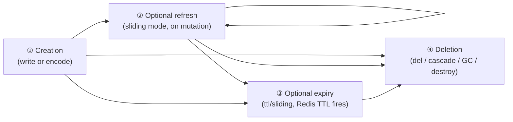
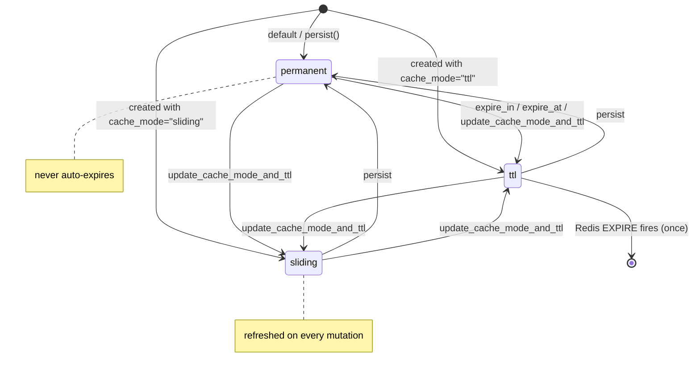
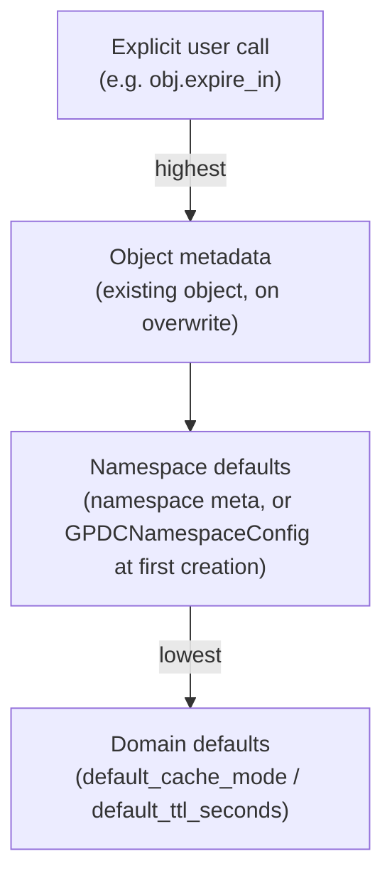
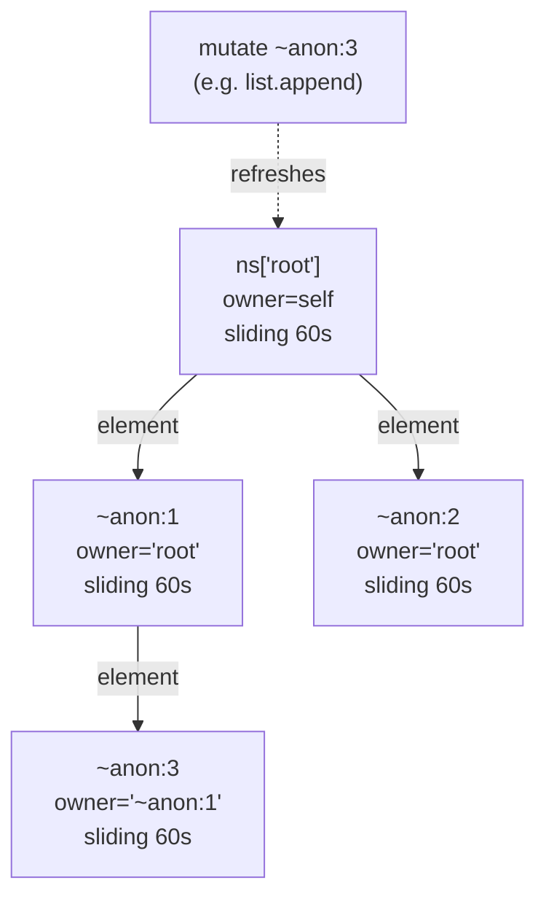
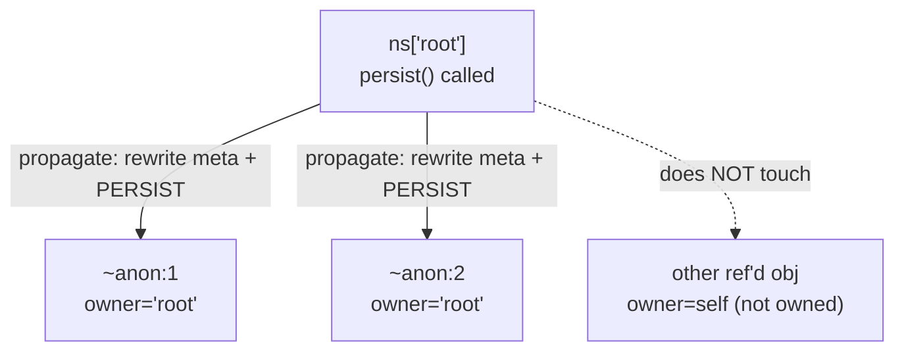
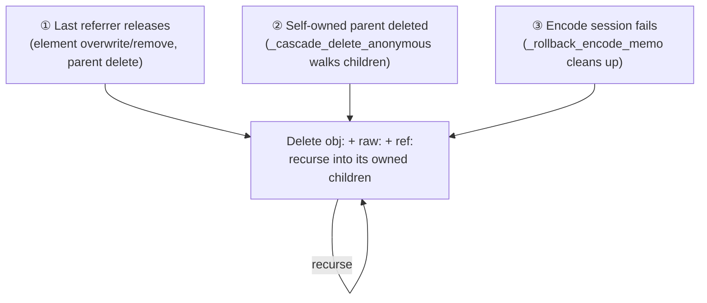

# Lifecycle Management

This document describes how `gpdatacached` manages the lifecycle of data objects — **creation, expiry, and deletion** — including the lifecycle of **anonymous** and **reference** objects, which behave differently from named owner objects.

Most users never need to manage lifecycle manually. The purpose of this document is to give you **correct expectations** about when objects appear, refresh, expire, and disappear, so that the library's automatic behaviour does not surprise you.

## 1. What "lifecycle" means here

A GPDC object's lifecycle has four phases:



GPDC automates **①②③** for you. You only touch lifecycle directly when you want to **change** an object's policy (make a permanent object expire, make a ttl object persist, etc.) or when you need to **delete** something explicitly. The part that most often confuses users is **how anonymous and reference objects enter and leave these phases** — sections [§8](#lifecycle-anon) and [§9](#lifecycle-reference) cover that in detail.

---

## 2. The Policy Model

Every object carries a `(cache_mode, ttl)` **policy**, stored as the `cache_mode` and `ttl` fields in its metadata hash.

| `cache_mode` | `ttl` | Semantics |
|---|---|---|
| `permanent` | `0` | Never expires. Redis `PERSIST` is applied. This is the **default**. |
| `ttl` | `> 0` | **Fixed expiry**: the object disappears once, `ttl` seconds after creation or last policy change. Mutations do **not** refresh the timer. |
| `sliding` | `> 0` | **Sliding window**: every mutation refreshes the TTL back to `ttl` seconds. The object survives as long as it is being touched. |

### State transitions



### Validation rules

The policy is validated strictly:

- `permanent` accepts any `ttl >= 0` (the value is silently ignored — Redis `PERSIST` is applied, so the object never expires).
- `ttl` and `sliding` require `ttl > 0`.
- `ttl` may never be negative.

Violating these raises `ValueError` at policy construction time (`policy_from_defaults`), so an invalid policy can never be written to Redis.

---

## 3. Policy Resolution: where defaults come from

When a **new** object is created, its initial policy is resolved from configuration in this priority order:



1. **Explicit user call** — `expire_in`, `expire_at`, `persist`, `update_cache_mode_and_ttl`. Always wins.
2. **Object metadata** — for an **existing scalar being overwritten in place**, the previous policy is preserved (see caveat below).
3. **Namespace defaults** — stored in the namespace meta hash. When the namespace is first created, these come from `GPDCNamespaceConfig` (if its fields are set); otherwise they inherit from the domain.
4. **Domain defaults** — `GPDCDomainConfig.default_cache_mode` (default `"permanent"`) and `default_ttl_seconds` (default `0`).

> ⚠️ **Overwrite caveat.** Only **scalar-overwrites-scalar** preserve the previous policy. **Overwriting a container** (which tears the old one down and re-creates it) and **replacing a reference binding** both reset the policy to namespace defaults. If you need a specific policy on a re-written container, set it explicitly after the write.

---

## 4. TTL Application Semantics

When GPDC applies a policy to an object, it walks the object's Redis keys and runs **either** `PERSIST` (no expiry) **or** `EXPIRE` (with `ttl` seconds):

| Policy | Redis call per key | Effect |
|---|---|---|
| `permanent` | `PERSIST key` | Strips any existing TTL. Key lives until explicitly deleted. |
| `ttl` | `EXPIRE key ttl` | Key disappears once, `ttl` seconds from now. |
| `sliding` | `EXPIRE key ttl` | Same as `ttl`, but re-applied on every mutation. |

### Which keys get TTL applied?

| Object kind | Keys touched by TTL |
|---|---|
| Scalar | `obj:{name}` (the metadata hash, which also holds the encoded value) |
| Container (canonical owner) | `obj:{name}` + `raw:{name}` + `ref:{name}` (all three share the object's TTL) |

This is why a container's metadata, raw data, and referrer set always vanish together — they share one TTL clock. Reference (alias) bindings are stored as plain Redis string keys with **no TTL applied** at creation — the alias persists until explicitly deleted. Lifecycle methods invoked through a reference (e.g. `expire_in`, `persist`) operate on the **canonical owner**, not on the alias binding.

---

## 5. Sliding-Window Refresh { #lifecycle-sliding }

The `sliding` mode is what makes GPDC useful for caches that should "stay alive while in use." Every mutation re-applies the TTL.

### What counts as a mutation?

| Trigger | Where | Refresh behaviour |
|---|---|---|
| Scalar `value = x` setter | `GPDCScalarObject.value.fset` | If `cache_mode == "sliding"` and `ttl > 0`, calls `refresh_ttl()`. |
| Any container mutating method (`append`, `__setitem__`, `extend`, `pop`, …) | `GPDCContainerObject._touch()` | Updates `updated_at`/`item_count`, then refreshes TTL — either of the container itself (if self-owned) or by propagating up the owner chain. |

A non-mutating **read** never refreshes TTL. Sliding refresh is strictly tied to writes.

### Upward propagation through the owner chain

When an anonymous child is mutated, its own TTL refresh would be useless — its lifetime is bounded by its parent's lifetime anyway. So GPDC **walks up the owner chain** and refreshes the TTL of the **first self-owned ancestor** (the named object that ultimately owns the subtree):



Mutating `~anon:3` walks `~anon:3 → ~anon:1 → root`, finds that `root` is self-owned, and refreshes **root's** TTL. The whole subtree stays alive as long as any descendant is being touched.

### Downward refresh of owned children

After refreshing the ancestor, GPDC also re-applies each owned child's **own** policy TTL to that child's keys (no metadata rewrite). Children whose policy declares no expiry (`permanent`, or `ttl/sliding` with `ttl=0`) are left untouched, but recursion still descends into them so deeper descendants are reached.

> ⚠️ **Performance note.** Because sliding refresh walks the entire owned subtree on every mutation, it is O(subtree size) per write. For large or high-churn containers this is the single most expensive lifecycle cost in GPDC. See [Performance Guide §3](./performance-guide.md#3-sliding-ttl-overuse) for guidance on when (and when not) to use sliding mode.

---

## 6. Manual Policy Changes & Cascade Propagation { #lifecycle-manual }

You rarely need to change policy mid-life, but when you do, GPDC propagates the change across the owned subtree.

### The user-facing mutators

| Method | Effect | Permission |
|---|---|---|
| `expire_in(seconds)` | Set new TTL. Requires existing `cache_mode == "ttl"` and `seconds > 0`. To delete now, use `expire_now()`. | Owner only. |
| `expire_at(when)` | Set absolute expiry time. Requires `cache_mode == "ttl"`. Deletes immediately if `when` is in the past (equivalent to `del ns[name]`: full teardown incl. anonymous subtrees; raises `CanonicalObjectReferencedError` if still referenced — check `has_referrers()` first). | Owner only. |
| `expire_now()` | Delete this object immediately (equivalent to `del ns[canonical_name]`: full teardown incl. anonymous subtrees; raises `CanonicalObjectReferencedError` if still referenced). Works in any `cache_mode` — use this instead of `expire_in(0)`/`expire_at(past)` when you want an explicit, mode-independent "delete now". | Owner only. |
| `persist()` | Switch to `permanent` with `ttl=0`. | Owner only. |
| `update_cache_mode_and_ttl(mode, ttl)` | Replace the full policy with `(mode, ttl)`. | Owner only. |

The four policy mutators (`expire_in`, `expire_at`, `persist`, `update_cache_mode_and_ttl`) delegate to `set_lifecycle(policy)` after a permission check (see [§7](#7-the-ownership-model)). `expire_now()` is the explicit delete-now entry point — it delegates to `del ns[canonical_name]` (full teardown), not to `set_lifecycle`.

### Cascade propagation

When an object's policy actually changes, GPDC:

1. Rewrites the object's own metadata (`cache_mode`, `ttl`, `updated_at`).
2. Re-applies TTL to the object's own keys.
3. Recursively walks the **owned subtree** and, for each owned child whose current policy differs, rewrites its metadata and re-applies TTL to its keys.

The walk is bounded by `owner == parent_name`: it only descends into children **owned by** the current parent (not arbitrary nested references). All metadata rewrites and TTL applications in one subtree level are batched into a single Redis pipeline.



> The propagation only changes **policy** and **TTL**, never data. It is safe to call on a live object.

---

## 7. The Ownership Model { #7-the-ownership-model }

Every object has an `owner` field in its metadata. Ownership determines who controls the object's lifecycle and is central to how anonymous objects work.

| `owner` value | Meaning | Who can change lifecycle? |
|---|---|---|
| Equal to the object's own canonical name | **Self-owned** (a named owner object). | Any process. The object is its own master. |
| Equal to some other name | **Owned by that parent** (typically an anonymous child created during encoding). | Only the parent (or the parent's owner, transitively). |

### The permission check

The four lifecycle mutators (`expire_in`, `expire_at`, `persist`, `update_cache_mode_and_ttl`) call `_check_owner_permission`, which raises `LifecyclePermissionError` when `meta.owner` is non-empty and differs from `self.canonical_name`. You cannot change the lifecycle of an anonymous child directly — you must change it on the self-owned ancestor that owns the subtree.

### `take_ownership()`

`take_ownership()` operates on **the referenced data object**, not on the reference (alias) binding. It makes **the referenced object** its own owner, so it can manage its own lifecycle independently.

The primary use case is a **named reference pointing at an anonymous nested object**. An anonymous object is created with `owner = parent` (its lifetime is attached to the parent container). When you hold a named reference to it, `take_ownership()` promotes the anonymous object to self-owned — its `owner` changes from the parent's name to its own `~anon:…` canonical name:

```python
ns["parent"] = {"inner": [1, 2, 3]}          # inner becomes ~anon:… owned by "parent"
inner = ns.get_object("parent")["inner"]      # the anonymous list object
ns["named"] = inner                           # a named reference to the anonymous object
obj = ns.get_object("named")
obj.take_ownership()                          # now the ~anon:… object owns itself;
                                             # owner = "~anon:…", independent of "parent"
# After this, obj.update_cache_mode_and_ttl("ttl", 60) sets a TTL on the ~anon:…
# object WITHOUT affecting "parent" — the anon now has its own lifecycle.
```

**On a reference to a named (already self-owned) object, `take_ownership()` is a correct no-op.** A named object is its own owner from creation, so the call changes nothing — which is the intended behaviour. In a multi-process shared environment a caller is not necessarily the data's creator and cannot (and need not) know whether a referenced object was created anonymous or named; the caller's intent — "this referenced object should manage its own lifecycle" — is *enacted* for an anonymous object and *already satisfied* for a named one. Either way the call is legitimate.

The call itself must be made **via a named reference handle**: `obj._is_reference` must be `True` and `obj.name` must not start with `~`. Calling it on a plain (non-reference) object raises `TypeError`.

---

## 8. Anonymous Object Lifecycle { #lifecycle-anon }

Anonymous objects are the **most automatic** part of GPDC. You never create or delete them directly. Understanding their lifecycle prevents most "where did my data go?" confusion.

### Creation

Anonymous objects are created **during encoding**, whenever a container is stored as a value **inside** another container:

```python
ns["matrix"] = [[1, 2], [3, 4]]      # two inner lists → two anonymous objects
ns["nested"] = {"a": [1, 2, 3]}       # the list value → one anonymous object
```

Each anonymous object gets a generated name (`~anon:{uuid}`), its own `obj:`/`raw:`/`ref:` keys, `owner` set to the **parent name that triggered its creation**, and an entry in the parent's referrer set (`ref:{anon}` → `{parent: count}`).

> Anonymous names are invisible: `iter(ns)`, `len(ns)`, `key in ns`, and `ns["~anon:..."]` (via the public API) all hide them. They exist only as backing storage for nested data.

### Lifecycle policy of an anonymous object

Anonymous objects inherit the policy that was active during encoding — i.e. the parent container's effective policy at create time (`policy_from_defaults` computed from the parent's context). After creation, their lifecycle is **driven by the owner chain**, not by their own policy alone:

- A `sliding` mutation on any descendant refreshes the self-owned ancestor's TTL (see [§5](#lifecycle-sliding)).
- A policy change on the self-owned ancestor propagates down to owned children (see [§6](#lifecycle-manual)).

### Reference counting

Each anonymous object has a `ref:` hash mapping **referrer name → slot count**. Multiple slots in the same parent can point at the same anon (e.g. the same list appears twice in a parent list), which is why the count can exceed 1.

### Cascade deletion triggers

An anonymous object is cascade-deleted in one of three situations:



1. **Last referrer release** — when the last slot referencing the anon is removed (an element is overwritten or popped, or the parent itself is deleted and walks its children). GPDC checks `has_referrers`; if empty and the target is anonymous, it cascades.
2. **Self-owned parent deletion** — `del ns["matrix"]` deletes the parent's binding, then `_cascade_delete_anonymous` walks the parent's stored raw data, releases nested refs, and recursively deletes any orphaned anons.
3. **Encode-session rollback** — if an exception propagates out of an `encode_session` (e.g. a `CyclicReferenceError`), every anonymous object created during that session is deleted and any ref-count increments the session made on pre-existing containers are reversed, leaving no orphan anons or phantom referrers behind. How far the cleanup reaches depends on the call site: a failed **first-time store** (`ns[name] = value`) is wrapped by `namespace.__setitem__`, which additionally deletes the just-written binding `obj:`/`raw:`/`ref:` keys, so no orphan meta survives at all; a failed **re-encode inside an existing container** (a mutator like `dict.update`/`list.extend`) only rolls back what the encode session created/referenced — the container's own long-standing `obj:`/`raw:` meta stays put (which is correct: it holds valid pre-existing data).

### Important consequence

**Anonymous objects are never "leaked" by GPDC.** Between the three cascade triggers and the GC (see [§10](#lifecycle-gc)), an anon that loses all referrers will be reclaimed. The worst case is a brief window between an ungraceful crash and the next GC cycle.

---

## 9. Reference (Alias) Lifecycle { #lifecycle-reference }

A **reference** is a named binding (`obj:alias` STRING holding `ref:{canonical_obj_key}`) that points at a canonical owner. References let multiple names share one piece of data without copying.

### Creation

```python
ns["alias"] = ns["original"]   # both names now resolve to the same canonical data
```

This writes a single `obj:alias` string key and bumps `original`'s referrer count. **No data is copied.** The reference binding itself has no policy metadata and no TTL applied — reading `cache_mode`/`ttl` through a reference returns the **canonical owner's** policy, because metadata is loaded from the canonical key.

### Reading

Reads transparently follow the reference: `ns["alias"]` resolves the pointer and returns the live container just like `ns["original"]` would. Locks resolve to the canonical name, so both aliases lock the same lock.

### Deletion

| You delete… | What happens |
|---|---|
| The alias (`del ns["alias"]`) | Removes the `obj:alias` string + decrements the canonical owner's ref count. If the canonical owner is anonymous and this was its last referrer, the anon is cascade-deleted. |
| The canonical owner (`del ns["original"]`) while aliases exist | **Raises `CanonicalObjectReferencedError`.** You must delete the aliases first. |

This protection is intentional: silently deleting data that other names still point at would be a footgun. The error's `.referrers` field tells you exactly which bindings to clean up.

### Lifecycle of a reference binding itself

A reference's `obj:alias` key has **no TTL applied**; it persists until explicitly deleted. Lifecycle mutators called on a reference operate on the **canonical owner**, not on the alias binding — use `take_ownership()` (see [§7](#7-the-ownership-model)) to promote **the referenced object** to self-owned so it can carry its own policy.

---

## 10. Garbage Collection { #lifecycle-gc }

GPDC's background GC cleans up **orphans** — keys left behind when objects expire or referrers churn. It does **not** replace the cascade-delete logic in [§8](#lifecycle-anon); it is a safety net for cases the synchronous path cannot handle atomically:

- **TTL expiry**: when a `ttl`/`sliding` object's Redis TTL fires, it vanishes, but referrers and referrer-set entries can linger.
- **Reference churn**: overwriting/removing container elements leaves stale `ref:` entries.

### What GC does

When `gc_enabled=True`, a background thread runs `run_gc_for_namespace` for each namespace on each `gc_interval_seconds` cycle. For each canonical name (processed under its own per-object lock, in ascending name order):

1. **Stale alias bindings** — `obj:alias` strings whose `ref:` target no longer exists are deleted.
2. **Orphan raw keys** — `raw:{name}` whose canonical `obj:{name}` is gone **and** which has no surviving referrer is deleted (along with its `ref:` key).
3. **Stale ref-set entries** — `ref:{name}` entries whose referrer no longer actually points at `{name}` are removed.

### Manual GC

You can trigger a cycle out of band:

```python
domain.run_gc(namespace=None)   # all namespaces, returns number of keys deleted
domain.run_gc("analytics")      # one namespace
```

### GC ↔ locking contract

If `gc_enabled=True`, **every concurrent writer must use `obj.lock()`**. The GC acquires the same per-object locks when it processes each canonical name; writers that bypass locking can race with GC. See [Multi-Process Locking](./locking.md) for the full contract.

> ⚠️ **Performance note.** Enabling GC imposes both an O(N) scan per cycle and the mandatory-locking contract (+2 RTT per mutation across all writers). For workloads that do not produce orphans (permanent-only, low churn), leave it off. See [Performance Guide §5](./performance-guide.md#5-unnecessary-garbage-collection).

---

## 11. The Manual Lifecycle API

For reference, here is the complete set of user-facing lifecycle methods on `GPDCDataObject`. **You only need these when you want to override the automatic behaviour.**

| Method | Purpose |
|---|---|
| `expire_in(seconds)` | Set a new TTL (must already be in `ttl` mode; `seconds > 0`). |
| `expire_at(when)` | Set absolute expiry (must already be in `ttl` mode). |
| `expire_now()` | Delete this object now (any cache mode; full teardown incl. anonymous subtrees). |
| `persist()` | Switch to `permanent`. |
| `update_cache_mode_and_ttl(mode, ttl)` | Replace the full policy. |
| `refresh_ttl()` | Force a sliding-window refresh of this object and its owned subtree. |
| `take_ownership()` | Promote **the referenced object** to own itself (primary use case: a named reference to an anonymous nested object; a correct no-op on a reference to an already self-owned named object). |
| `ttl` (property) | The declared TTL in seconds. |
| `cache_mode` (property) | The current cache mode. |
| `remaining_ttl()` | The actual remaining TTL reported by Redis (0; -1 = no expiry; -2 = key already gone). |
| `created_at` / `updated_at` (properties) | Timestamps from metadata. |

Plus the domain-level `domain.run_gc(namespace=None)` for manual GC.

For the full signature details, see the [API reference](./api.md).

---

## 12. Expectations & Common Pitfalls

A short list of "I expected X, but got Y" scenarios, resolved.

| Expectation | Reality | Why |
|---|---|---|
| "I overwrote my container and it kept its TTL" | The container's policy was **reset** to namespace defaults. | Overwriting a container tears it down and re-creates it; only scalar-over-scalar preserves policy. Set the policy explicitly after the write. |
| "My sliding object's TTL refreshed on read" | Reads never refresh TTL. Only mutations do. | Sliding is strictly write-driven. |
| "I deleted a list element and an unrelated anon vanished" | The anon was only referenced from that slot; the cascade-delete correctly reclaimed it. | Anonymous objects are ref-counted; last release deletes. |
| "I can't delete my container — it raised `CanonicalObjectReferencedError`" | Another name still references it. | Delete the aliases first; the error lists them in `.referrers`. |
| "My anonymous child won't `expire_in()`" | You don't own it. | Anonymous children have `owner = parent`. Call the mutator on the self-owned ancestor. |
| "`ttl` mode with `ttl=0` was accepted" | Never. It raises `ValueError`. | Strict validation: `ttl`/`sliding` require `ttl > 0`. |
| "My `permanent` object disappeared" | Something deleted it (`del`, namespace `clear()`, `destroy()`, or GC of an orphaned anon). | `permanent` only means no TTL; it is not immortality. |
| "I changed the ancestor to `permanent` but a child still has a TTL" | Propagation only reaches **owned** children. | Children referenced but not **owned** by the ancestor keep their own policy. |
| "My data vanished after a crash mid-write" | The encode session rolled back all anonymous objects created during the failed write (and, for a first-time store, the binding's `obj:`/`raw:`/`ref:` keys too). | This is intentional: a failed write leaves no orphan anons behind. For a first-time store the whole binding is cleaned up; for a re-encode inside an existing container, the container's own pre-existing meta is intentionally left in place (it holds valid data). |

---

## Further Reading

- **[Overview](./overview.md)** — the architecture this lifecycle model sits inside, especially §8 (Lifecycle & GC).
- **[API Reference](./api.md)** — full signatures of the lifecycle methods and the `ObjectMeta` model.
- **[Multi-Process Locking](./locking.md)** — the GC ↔ writer contract and lock semantics.
