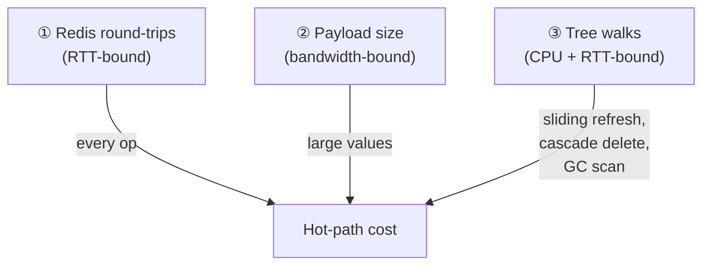
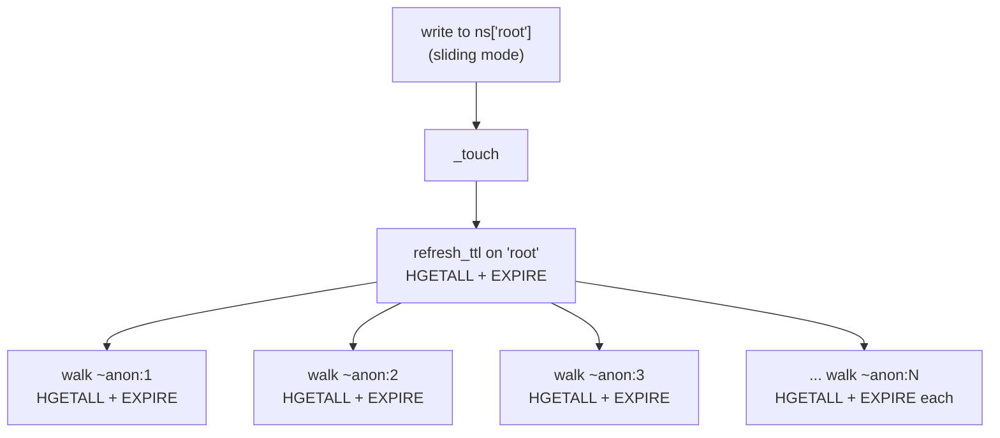

# Performance Guide

This guide lists the usage patterns that can **seriously degrade** `gpdatacached`'s performance, explains *why* each is expensive, and gives the recommended alternative. Read it once before putting GPDC on a hot path.

Most of these pitfalls are not bugs — they are inherent costs of operations GPDC *can* perform but that you should use deliberately, not by default.

## 1. The Cost Model

Three things dominate GPDC performance. Internalise them and the rest of this guide follows naturally.



1. **Redis round-trips (RTT).** Every GPDC operation is one or more Redis round-trips. On a LAN that is ~0.2–2 ms per RTT; over a WAN it can be 10–100 ms. Small operations are **latency-bound**, not throughput-bound.
2. **Payload size.** Large values (big strings, big lists) cost bandwidth and Redis CPU time to (de)serialise. Re-encoding a 10 MB structure on every write is expensive regardless of RTT.
3. **Tree walks.** Several GPDC operations walk a subtree of objects: sliding-TTL refresh, lifecycle cascade propagation, cascade-delete, and GC. Their cost is proportional to the **owned subtree size**, and each step typically costs a Redis round-trip.

The anti-patterns below all boil down to **triggering one of these costs unnecessarily often, or on unnecessarily large subtrees**.

---

## 2. Cost-per-Operation Reference { #perf-cost-ref }

A quick reference. "RTT" = Redis round-trip. N = number of elements; counts are approximate and ignore contention. Where helpful, "local" marks work that does not hit Redis.

| Operation | Cost class | Notes (verified against source) |
|---|---|---|
| `ns[k] = scalar` | O(1), ~5 RTT (new) / ~4 RTT (overwrite) | `TYPE` (resolve) + `HGET` ×2 (namespace-default policy) + `HSET` (metadata) + one TTL apply (`PERSIST`/`EXPIRE`). Overwrite re-uses the existing policy (no namespace-default reads) and instead re-reads the existing meta during resolve (`HGETALL`). |
| `ns[k]` (scalar read) | O(1), ~3 RTT | `_resolve_binding` (`TYPE` + `HGETALL`) **plus** the scalar `.value` getter re-loads meta (`HGETALL`). |
| `ns[k] = [a, b, c]` (flat, scalar-element container) | O(N) local encode, **O(1)** data-write RTT | One `encode_session` + one bulk `create_raw` (single `RPUSH`/`HSET`/`SADD` carrying all elements) + `HGET` ×2 (namespace-default policy) + metadata `HSET` + TTL applies on the obj/raw/ref keys (≈ 8 RTT total, independent of N for scalar elements). |
| `ns[k] = [[...], ...]` (nested container) | O(**nested-container count**) RTT + O(N) local | Each nested container becomes one anonymous object (meta `HSET` + its own `create_raw` + `HINCRBY` ref + TTL applies ≈ 5–6 RTT each). Depth does **not** multiply — it is the total node count that scales. |
| `container.append(x)` / `container[k] = v` (scalar element, non-sliding) | O(1), ~5–6 RTT | `HGETALL` (policy) + data write (`RPUSH`/`HSET`) + `_touch` (`LLEN`/`HLEN` + `HGETALL` + `HSET`). **Add the sliding-subtree walk if `cache_mode="sliding"`** (§3); **add ~5–6 RTT if the element is itself a container** (anonymous-object creation). |
| `iter(ns)` / `len(ns)` | O(N), batched SCAN | A few RTT per ~100-key SCAN page (`len` delegates to `iter`). Don't put in a hot loop. |
| `k in ns` | O(1), 1–4 RTT | Direct `TYPE` + `HGETALL` on the named key (1–2 RTT for owner bindings); references add a `GET` + another `TYPE` (up to 4 RTT for aliases). **Not** a SCAN. Does not scale with namespace size. |
| `del ns[k]` (container owner) | O(owned subtree size) | `_teardown_owner_container` releases each nested ref (`HDEL`) and cascade-deletes orphaned anonymous children; ~1+ RTT per node. Raises `CanonicalObjectReferencedError` if live alias referrers exist — delete those first. |
| `ns[k] = new_container` (overwrite) | O(old + new subtree) | Full teardown of the old + full encode of the new — see [§8](#8-container-overwrite-vs-in-place-mutation). |
| `obj.lock()` + release (uncontended) | +2 RTT | `SET NX EX` + one Lua release script. |
| Sliding refresh triggered by a mutation | O(owned subtree size) | Per owned child: `HGETALL` + TTL re-apply. See [§3](#3-sliding-ttl-overuse). |
| `obj.persist()` / `update_cache_mode_and_ttl(...)` | O(owned subtree size) | Rewrites metadata (`HSET`) + re-applies TTL across the subtree, one pipeline per level. |
| `domain.run_gc()` | O(N canonical names) | Three `SCAN` families + per-name lock acquire + type/existence checks. See [§5](#5-unnecessary-garbage-collection). |
| `.value` (full container read) | flat: 1 RTT + O(N) local; nested: +O(nested count) RTT | One bulk read (`LRANGE`/`HGETALL`/`SMEMBERS`); each `ref:` element adds one `HGETALL` + decode for its anonymous object. |
| `name in cache` (`GPDataCache`) | **local, 0 RTT** | Pure config-snapshot check via `folder.list_configs()`. Does not touch Redis and does not construct a domain. The cheapest membership test in the library. |
| `cache.get_domain(name)` | 1st call: domain construction (domain-meta read/verify); subsequent: **0 RTT** | First access constructs and caches the `GPDCDomain` via gpconfig's factory; later calls return the cached instance. Does not re-read config files. |
| `cache.get_object_by_uri(uri)` | root: ~4–5 RTT; **+1 RTT per path segment** | `get_namespace` (`SISMEMBER` + namespace-meta `HGETALL`, ~2 RTT) + root resolve (`TYPE` + `HGETALL`, ~2–3 RTT). Each extra path segment is one `__getitem__` read (`LINDEX` for `ListObject`, `HGET` for `DictObject`). `cache.has_uri(uri)` has the same cost (it calls `get_object_by_uri` under a try/except). The domain is only constructed on the first access; later URIs in the same domain reuse the cached domain. |

---

## 3. Sliding TTL Overuse

`cache_mode="sliding"` refreshes the TTL on every mutation. **The refresh walks the entire owned subtree.** This is the single most overlooked performance cost in GPDC.

### Why it is expensive

When a self-owned container in sliding mode is mutated, GPDC calls `refresh_ttl()`, which:

1. Re-applies `EXPIRE`/`PERSIST` to the object's own keys (after a `HGETALL` to load its meta).
2. Recursively descends every **owned child**: per child it does a `HGETALL` (to read that child's own policy) and re-applies its TTL to its keys.
3. Returns only when the whole owned subtree has been walked.

So the cost of **one** `append` on a sliding list that owns 1000 anonymous children is **thousands** of Redis round-trips — a `HGETALL` + TTL re-apply per owned child (each step is an individual round-trip; this path is not pipelined, unlike `persist()`/`update_cache_mode_and_ttl()` which batch one pipeline per tree level). In a frequent-write loop this multiplies your apparent write cost by the subtree size.



### Recommendation

- **Default to `permanent` or `ttl`.** They never trigger subtree walks on write. `ttl` expires once and is done; no per-mutation cost.
- **Use `sliding` surgically.** Reserve it for the specific objects that genuinely need "stay-alive-while-touched" semantics — typically a small number of session-like or hot-cache objects.
- **Keep sliding objects shallow.** Because the refresh is O(owned subtree size), a sliding container with deeply nested anon children is the worst case. If you must use sliding, prefer flat structures.
- **Avoid `sliding` on high-churn containers** (frequent appends/pops). Each mutation pays the full subtree walk.

> The full mechanics — owner chain, upward vs downward propagation, validation rules — are in [Lifecycle Management](./lifecycle.md#lifecycle-sliding).

---

## 4. Excessive Container Nesting { #perf-nesting }

GPDC supports nesting containers to arbitrary depth (`ns["x"] = [[[[1]]]]` works). Each nesting level has a real cost.

### What nesting costs

Every nested container is materialised as a **separate anonymous object** with its own `obj:` / `raw:` / `ref:` keys, ref-counted and owner-linked. Storing `[[[1, 2], [3, 4]], [[5, 6]]]` creates 5 anonymous objects (one per inner list), each requiring:

- An `encode_element` call that writes a `ref:` pointer into the parent's raw data.
- A metadata hash write (`HSET`).
- A raw-key write.
- A referrer-set increment (`HINCRBY`).
- A TTL application (`EXPIRE` / `PERSIST`).

On **read**, `.value` loads each anonymous child's meta (one `HGETALL` per `ref:` element) and returns a live `GPDCContainerObject` handle for each — it does **not** recursively decode nested data. Use `.deepcopy()` if you need the fully decoded Python structure (it recursively materialises every level).

On **mutation**, the sliding-refresh and cascade-delete costs scale with the subtree size (see [§3](#3-sliding-ttl-overuse) and [§10](#perf-ref-churn)).

### Recommendation

- **Keep nesting shallow.** One or two levels is usually fine. Beyond that, reconsider your data model.
- **Prefer flat structures** when the nested representation is not semantically essential. A flat list of scalar tuples often expresses the same data with one level instead of three.
- **Store large sub-structures as named objects** and reference them by name, instead of nesting them as anonymous children. Named objects are cheaper to update independently (no subtree walk on the parent).
- **For tabular data, use `DataFrameObject`** (see [Pandas Support](./pandas-support.md)) rather than a list-of-lists — it is stored columnarly and is far cheaper to read selectively.

> Nesting is implemented via the encode/decode element protocol; see [Extensibility §10](./extensibility.md#10-element-encoding-scalar-members-vs-nested-containers).

---

## 5. Unnecessary Garbage Collection

`gc_enabled=True` starts a background GC thread. GC is a **safety net** for orphaned keys produced by TTL expiry and reference churn — it is not required for correctness in workloads that do not produce orphans.

### Why enabling GC is expensive

Two costs:

1. **The GC cycle itself.** Each `run_gc_for_namespace` does three `SCAN` families (`obj:` / `raw:` / `ref:`) — O(N) where N is the number of canonical names — and for each canonical name acquires the per-object lock and runs several type/existence checks. On a namespace with millions of objects this is noticeable.
2. **The mandatory-locking contract.** This is the bigger cost. When `gc_enabled=True`, **every writer must use `obj.lock()`** — including your own writer thread racing the GC thread in the same process. That means **+2 RTT per mutation** on every contended object, plus lock serialisation. See [§6](#perf-lock-misuse) and [Multi-Process Locking](./locking.md).

### Recommendation

- **Leave GC off by default.** `GPDCDomainConfig(gc_enabled=False)` is the default for a reason.
- **Enable GC only when you actually produce orphans** — i.e. when you use `ttl` or `sliding` objects that can expire leaving referrer entries, or when you have high reference churn on anonymous children. A workload that only stores `permanent` objects and rarely deletes produces essentially no orphans; GC gains you nothing and costs the locking overhead.
- **Run GC manually in a maintenance window** if orphan volume is low: `domain.run_gc(namespace=None)` returns the number of keys deleted. This avoids both the background thread and the always-on locking contract.
- **If you do enable GC, accept the locking cost** and budget the +2 RTT per mutation across all writers. See [Multi-Process Locking](./locking.md) for the full contract.

> For what GC cleans and when, see [Lifecycle Management §10](./lifecycle.md#lifecycle-gc).

---

## 6. Lock Misuse { #perf-lock-misuse }

Locks are **opt-in and advisory**, and they are not free. The full analysis is in [Multi-Process Locking → Performance Impact](./locking.md#locking-perf); the short version:

- An **uncontended** `obj.lock()` adds **+2 RTT** (acquire + release) per operation.
- A **contended** lock serialises access: throughput drops to `1 / (critical_section + 2·RTT)`.
- **`gc_enabled=True` forces locking on every mutation** (see [§5](#5-unnecessary-garbage-collection)).

### Anti-patterns

- **Locking speculatively.** Adding `obj.lock()` "to be safe" when there is no measured contention multiplies your RTT cost for no benefit. GPDC's per-command operations are already atomic.
- **Locking inside a hot loop.** N iterations × +2 RTT dwarfs the actual work. Either hoist the lock to wrap the whole loop, or pull data local via `.value` and work on it.
- **Holding the lock across I/O or heavy compute.** This serialises every other waiter behind your unrelated work.
- **Locking a different object than you mutate.** Locks are keyed on canonical name; locking `obj_A` does not protect writes to `obj_B`.

### Recommendation

- **Default to no locks.** Add them reactively, in response to measured contention on a specific object.
- **Keep critical sections minimal** — read → compute → write, nothing else.
- **Prefer `try_lock()`** for opportunistic paths where you can defer.

> Full rules of thumb and the cost table are in [Multi-Process Locking → Recommended Usage](./locking.md#locking-recommended).

---

## 7. Round-Trip Anti-Patterns

Because every operation is one or more Redis round-trips, the surest way to wreck performance is to issue many of them in a loop.

### Anti-pattern: per-element loop

```python
# BAD: N round-trips to read, N to write back
total = 0
for i in range(len(ns["scores"])):
    total += ns["scores"][i]
```

```python
# GOOD: one round-trip to materialise, work locally
scores = ns["scores"].value        # one read
total = sum(scores)
```

```python
# GOOD: one mutating call, not N
ns["scores"].extend(new_values)    # one pipeline, not N appends
```

### Anti-pattern: read-modify-write on the whole structure

```python
# BAD: decode + re-encode the whole list to change one cell
data = ns["matrix"].value
data[0][0] = 99
ns["matrix"] = data                # full teardown + recreate (see §8)
```

```python
# GOOD: mutate one cell in place
ns["matrix"][0][0] = 99            # one targeted write
```

### Recommendation

- **Use container mutating methods** (`append`, `extend`, `__setitem__`, `pop`, …) — they hit Redis directly at the element level.
- **Pull data local once** with `.value` when you need to do many operations on the same data, then write the result back in one pass.
- **Batch appends** with `extend(...)` rather than many `append(...)` calls.
- **For pandas**, see [Pandas Support → Accessor Cost Guide](./pandas-support.md#pandas-cost-guide): use online selective accessors for one-shot subset reads; use `.value` for heavy repeated work. Never ping the cache per-row or per-cell.

---

## 8. Container Overwrite vs In-Place Mutation

Overwriting a container binding (`ns[k] = new_container`) is **much** more expensive than mutating it in place.

### Why

`ns[k] = new_value` on an existing container binding:

1. Resolves the existing binding.
2. Checks for referrers (raises `CanonicalObjectReferencedError` if any exist).
3. **Tears down** the old container: scans its raw data for nested refs, releases every nested anonymous child's referrer, deletes the raw key and ref key.
4. **Re-creates** from scratch: a full `encode_session` + `create_raw`, producing a fresh set of anonymous children.
5. Resets the policy to namespace defaults (does not preserve the previous policy).

The total cost is **O(old subtree size + new subtree size)**. For a large list this is a full re-encode on every write.

### Recommendation

- **Mutate in place** via the container's methods (`append`, `__setitem__`, `extend`, …). These are O(1) per element (plus `_touch()`).
- **Avoid `ns[k] = whole_new_structure`** in hot paths.
- **For full rewrites**, accept the cost but be aware of it. If you need to do this frequently on a large structure, reconsider the data model.

---

## 9. Enumeration Costs

`iter(ns)` and `len(ns)` are **SCAN-based** and O(N) in the number of named objects in the namespace. They are batched (a pipeline per SCAN page) but still scale linearly. (`len(ns)` delegates to `iter(ns)`.)

> Note: `k in ns` is **not** in this category — it resolves the named key directly (`TYPE` + `HGETALL`, or `GET` + `TYPE` + `HGETALL` for a reference). It is O(1) and 1–4 RTTs per check, regardless of namespace size. It is only worth replacing if you are doing it in a tight loop where even 1–4 RTTs per iteration adds up.

### Anti-pattern

```python
# BAD: O(N) scan per iteration
for name in ns:                    # SCAN
    if name.startswith("user."):   # object names allow letters/digits/'.'/'_'
        process(ns[name])
```

### Recommendation

- **Don't put `iter(ns)` / `len(ns)` in hot loops.** Cache the result if you need it more than once.
- **For high-frequency membership tests, don't put `k in ns` in a tight loop either** — each check is still a Redis round-trip. Either maintain your own index (a `SetObject` of valid names), or just try to read and catch `KeyError`.
- **`cache.has_uri(uri)` / `cache.get_object_by_uri(uri)` are not free either** — each costs a Redis round-trip (plus one per path segment; see [§2](#perf-cost-ref)). For a tight existence-check loop over the same set of URIs, cache the result locally rather than re-resolving each iteration. (`name in cache`, by contrast, is a local 0-RTT config check.)
- **For namespace-wide cleanup, prefer `ns.clear()`** (one bulk SCAN+DELETE) over repeated `del ns[k]` calls.

---

## 10. Reference Churn { #perf-ref-churn }

Containers that hold **nested anonymous children** pay a cost on every structural change: removing or overwriting an element releases a ref, and when the last referrer of an anonymous child goes, the child is cascade-deleted (which itself walks *its* children). High churn on such structures produces continuous ref-tracking traffic and cascade-delete cascades.

### Anti-pattern

```python
# A queue of work items, each a nested dict, with high throughput
ns["queue"] = []                       # list of dicts
while True:
    item = make_item()                 # a dict
    ns["queue"].append(item)           # creates an anon per append
    ...
    ns["queue"].pop(0)                 # releases an anon, cascade-deletes it
```

Every `append` + `pop` cycle creates and then cascade-deletes an anonymous object — multiple round-trips of bookkeeping per item.

### Recommendation

- **Use flat, scalar-element containers for high-churn data.** A list of scalars, or a list of tuples, or a list of encoded strings — no nested anons per element.
- **For queues/logs, store entries as scalars** (e.g. JSON-encoded strings, or tuples) rather than as nested containers. You lose live nested mutation but gain O(1) churn.
- **If you need nested structure with high read churn but low write churn**, nesting is fine — the cost is on the write/delete path.

---

## 11. Network Topology

Because RTT dominates small operations, where Redis lives matters as much as how you use it.

### Recommendation

- **Co-locate the GPDC client with Redis.** Same host or same datacenter; sub-millisecond RTT is the design target.
- **Don't share one GPDC domain across WAN regions.** Cross-region RTTs (10–100 ms) make every operation feel slow.
- **Connection pooling is already handled** — `GPDCDomain` opens one `redis.ConnectionPool` and reuses it. You do not need to manage connections yourself.
- **If you need cross-region sharing**, consider one Redis per region with application-level replication, rather than one GPDC domain stretched across regions.

---

## 12. Do / Don't Summary

| ✅ Do | ❌ Don't |
|---|---|
| Default to `permanent` / `ttl` cache modes | Put `sliding` on large or high-churn containers by default |
| Use `sliding` only on small, specific "stay-alive" objects | Enable sliding fleet-wide |
| Keep container nesting shallow (1–2 levels) | Store deeply nested structures (`[[[...]]]`) on hot paths |
| Store large sub-structures as named objects | Nest everything as anonymous children |
| Leave `gc_enabled=False` by default | Turn on GC "just in case" when you have no `ttl`/`sliding` objects |
| Run `domain.run_gc()` manually in maintenance windows | Leave the background GC on a permanent-only workload |
| Add locks only on measured contention | Lock speculatively or inside hot loops |
| Use container mutating methods (`append`, `__setitem__`, `extend`) | Read-modify-write the whole structure via `ns[k] = ...` |
| Pull data local with `.value` for heavy repeated work | Ping the cache per-element in a loop |
| Co-locate with Redis | Stretch one domain across a WAN |
| Maintain your own index for high-frequency lookups | Put `iter(ns)` / `k in ns` in hot loops |
| Use flat scalar-element containers for high-churn queues | Use nested-container-per-element for high-throughput queues |

---

## Further Reading

- **[Multi-Process Locking → Performance Impact](./locking.md#locking-perf)** — the lock cost model in detail.
- **[Lifecycle Management → Sliding-Window Refresh](./lifecycle.md#lifecycle-sliding)** — why sliding refresh walks the subtree.
- **[Lifecycle Management → Garbage Collection](./lifecycle.md#lifecycle-gc)** — what GC actually does each cycle.
- **[Pandas Support → Accessor Cost Guide](./pandas-support.md#pandas-cost-guide)** — selective read vs full restore costs.
