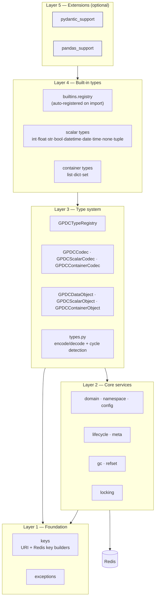
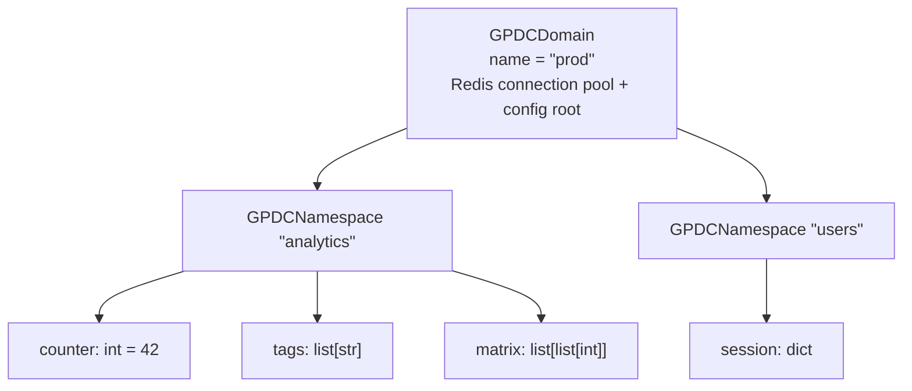
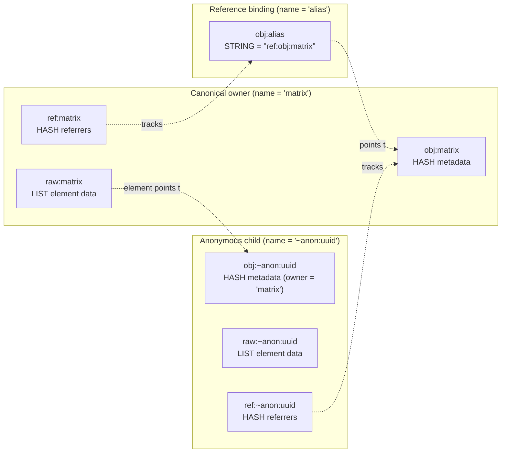
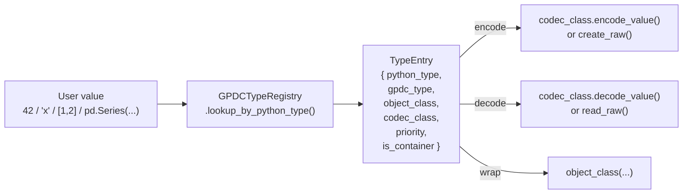

# Overview

This document explains **why** `gpdatacached` exists, **how** it is organised, and the **concepts** you need to understand its architecture. It is intentionally light on API usage — for that, see the [API Reference](./api.md).

> Read this in another language: [简体中文](./zh-CN/overview.md)

---

## Table of Contents

- [1. Why gpdatacached?](#1-why-gpdatacached)
- [2. Design Philosophy](#2-design-philosophy)
- [3. Architecture](#3-architecture)
- [4. The Domain → Namespace → Object Model](#4-the-domain--namespace--object-model)
- [5. Redis Key Layout](#5-redis-key-layout)
- [6. Object Model: Owners, References, Anonymous Objects](#6-object-model-owners-references-anonymous-objects)
- [7. Encoding & Codec System](#7-encoding--codec-system)
- [8. Lifecycle & Garbage Collection](#8-lifecycle--garbage-collection)
- [9. Concurrency Model](#9-concurrency-model)
- [10. Extensibility](#10-extensibility)

---

## 1. Why gpdatacached?

### The problem

Sharing **mutable state across processes** is hard.

- `multiprocessing.Manager` proxies every access through a single server process — a bottleneck and a single point of failure.
- Raw Redis forces you to (de)serialise everything by hand. You get no type safety, no reference tracking, no TTL cascades, no cross-process locking.
- Embedded caches (functools, diskcache, etc.) are per-process: each process keeps its own copy and there is no shared truth.

### What gpdatacached provides

`gpdatacached` turns Redis into a **shared, typed, live object store** that any Python process can use as if it were a local dict:

- A dict-like API on top of Redis with **typed values** (`int`, `str`, `datetime`, `list`, `dict`, `set`, …).
- **Live containers** — `ns["tags"].append("x")` mutates Redis directly; no read-modify-write race on the whole structure.
- **Reference sharing** — bind the same container under multiple names; the data is stored once.
- **Per-object lifecycle** — `permanent` / `ttl` / `sliding-window` cache modes with cascade propagation.
- **Background GC** — reclaims expired and orphaned objects.
- **Opt-in distributed locking** — serialize writes across processes when you actually have contention.

Redis is the single source of truth. There is no client-side cache layer, so there is no invalidation problem: every read goes to Redis and sees the latest committed write.

---

## 2. Design Philosophy

Six principles shape the library:

| # | Principle | Consequence |
|---|---|---|
| 1 | **Redis is the source of truth** | No client cache, no invalidation. Every read is live. |
| 2 | **Dict-like ergonomics, typed backing** | `ns["x"] = 42` works; but `42` is type-checked, encoded, and stored with metadata. |
| 3 | **Scalars native, containers live** | Scalars return Python values on read; containers return live objects so mutations hit Redis directly. |
| 4 | **Reference sharing is bounded by namespace** | Cross-namespace references are forbidden, so a namespace can be bulk-deleted safely. |
| 5 | **Lifecycle and concurrency are explicit** | Cache mode lives on each object; locking is opt-in and never automatic. |
| 6 | **Codec-driven extensibility** | Every type is a `(python_type, object_class, codec_class)` triple registered with a global registry. |

Principle **#3** is the most distinctive: it is what makes the library feel like a local data structure instead of a remote cache.

```text
                ns["price"] = 42              ns["tags"] = ["a","b"]
                       │                              │
                       ▼                              ▼
        ┌────────────────────────┐     ┌────────────────────────────┐
        │  encoded scalar value  │     │   live container object    │
        │   stored in meta hash  │     │  stored in raw Redis list  │
        └────────────────────────┘     └────────────────────────────┘
                       │                              │
                       ▼                              ▼
         ns["price"] ──► 42            ns["tags"] ──► ListObject
         (native Python int)           (live proxy: .append/.pop hit Redis)
```

---

## 3. Architecture

`gpdatacached` is organised in five layers. Each layer depends only on the layers below it.



| Layer | Responsibility | Key modules |
|---|---|---|
| **Foundation** | Redis key builders, URI scheme, exceptions. No state. | `keys`, `exceptions` |
| **Core services** | The Domain/Namespace façade, metadata model, lifecycle policy, GC, locking, ref counting. | `domain`, `namespace`, `config`, `meta`, `lifecycle`, `gc`, `locking`, `refset` |
| **Type system** | The type registry, codec ABCs, object ABCs, encode/decode element protocol. | `types`, `codec`, `object`, `scalar`, `container` |
| **Built-in types** | Concrete scalar/container classes and their codecs, auto-registered on import. | `builtins/*` |
| **Extensions** | Optional type families for third-party libraries. | `extensions/pydantic_support`, `extensions/pandas_support` |

Everything below Layer 5 is loaded automatically by `import gpdatacached`. Extensions are opt-in.

---

## 4. The Domain → Namespace → Object Model

GPDC organises data in three nesting levels. Each level is a logical scope; together they form the GPDC **URI** `gpdc://{domain}/{namespace}/{name}`.



| Level | Role | Examples of what lives here |
|---|---|---|
| **Domain** | Configuration root + Redis connection pool + lock/GC defaults. Identified by name. | `redis_host`, `default_cache_mode`, `gc_enabled`, `default_lock_ttl_seconds` |
| **Namespace** | A logical isolation space inside a domain. Behaves like a `MutableMapping`. | the set of object names; per-namespace cache defaults |
| **Data Object** | A named, typed value. Either a scalar (single value) or a container (elements in a raw Redis key). | metadata hash (`type`, `value`, `cache_mode`, `ttl`, `owner`, …), optional raw data, optional referrer set |

### Why three levels?

- **Domain** is the deployment unit: one Redis database, one set of lock/GC parameters. Multiple processes open the same domain to share data.
- **Namespace** is the isolation unit: a flat name space that can be cleared, listed, and deleted independently. This is also the **boundary for reference sharing** — see principle #4.
- **Object** is the value unit: one logical piece of data with its own lifecycle and (optionally) lock.

### Identity: canonical name vs binding name

Every object has two names:

- The **binding name** — the key the user used to fetch it.
- The **canonical name** — the name that actually owns the underlying Redis data.

For a normal object these are identical. For a **reference** (alias) they differ, and many binding names can point at one canonical owner. This is explained in detail in [§6](#6-object-model-owners-references-anonymous-objects).

---

## 5. Redis Key Layout

Every GPDC key starts with the `gpdc:` prefix and encodes the domain/namespace/name scope in a predictable way. Knowing this layout helps you inspect and operate on GPDC data directly from `redis-cli`.

```text
gpdc:__meta__                                   global metadata (protocol version)
gpdc:__domains__                                SET of all registered domain names

gpdc:{domain}:__meta__                          HASH — domain metadata
gpdc:{domain}:__namespaces__                    SET of namespace names in the domain

gpdc:{domain}:{ns}:__meta__                     HASH — namespace metadata

gpdc:{domain}:{ns}:obj:{name}                   object key:
                                                  ├─ HASH   → metadata (canonical owner)
                                                  └─ STRING → "ref:{canonical_obj_key}" (alias binding)

gpdc:{domain}:{ns}:raw:{name}                   container raw data:
                                                  ├─ LIST   (ListObject)
                                                  ├─ HASH   (DictObject / pydantic / DataFrame)
                                                  └─ SET    (SetObject)

gpdc:{domain}:{ns}:ref:{name}                   HASH — referrer_name → ref_count

gpdc:{domain}:{ns}:lock:{name}                  STRING — distributed lock token (SET NX EX)
gpdc:{domain}:{ns}:locknotify:{name}            LIST  — BLPOP wake-up queue for the lock
```

**Three key families per object.** A canonical container object owns up to three keys — `obj:` (metadata hash), `raw:` (element data), `ref:` (referrer set). A scalar owns only `obj:`. Aliases own only a single `obj:` string holding the `ref:` pointer.

**Reserved names.** Names matching `__xxx__` are reserved (used for the meta keys above) and rejected by the validators. Names starting with `~` are anonymous objects (see [§6](#6-object-model-owners-references-anonymous-objects)) and are hidden from the public mapping API.

---

## 6. Object Model: Owners, References, Anonymous Objects

This is the conceptual core of GPDC. Three kinds of object binding live in the same key space:



### Canonical owner

A named object that **owns** its raw data. Its `obj:` key is a HASH holding metadata; `raw:` and `ref:` keys exist if it is a container.

### Reference (alias) binding

When you write `ns["alias"] = ns["matrix"]`, GPDC does **not** copy the data. It creates a tiny `obj:alias` STRING key holding `ref:{obj_key_of_matrix}` and bumps matrix's referrer count. Both names now resolve to the same canonical owner.

- Reads transparently follow the reference: `ns["alias"]` returns the live container, just like `ns["matrix"]`.
- Locks resolve to the canonical name, so `ns.get_object("alias").lock()` and `ns.get_object("matrix").lock()` contend on the **same** lock.
- Deleting an alias only removes the binding; the canonical data survives until its last referrer is gone.

### Anonymous objects

When you store a **nested container** — `ns["matrix"] = [[1, 2], [3, 4]]` — each inner list is materialised as an anonymous object with a generated name like `~anon:{uuid}`. Anonymous objects:

- Are tracked by **reference count** in their `ref:` hash (one entry per referrer, value = slot count).
- Have their `owner` metadata set to the parent that created them.
- Are **cascade-deleted** when their last referrer goes away (e.g. when the parent is deleted, or when an element is overwritten/removed).
- Are hidden from `iter(ns)`, `len(ns)`, and `in` checks.

### Why no cross-namespace references?

Principle #4: a namespace is a self-contained reference graph. This lets `ns.clear()` and `domain.delete_namespace()` delete every key in bulk (`SCAN + DELETE`) without walking per-object referrer cleanup. If references could cross namespace boundaries, bulk deletion would risk orphaning or corrupting another namespace's data.

---

## 7. Encoding & Codec System

Every Python value that flows into GPDC is **encoded** by a codec into a string, and **decoded** back on read. Two encoding flavours exist.

### Scalar encoding: `type:payload`

A scalar value is encoded inline as `{type_prefix}:{payload}`:

```text
42            ──►  "int:42"
3.14          ──►  "float:3.14"
True          ──►  "bool:True"
"hello"       ──►  "str:hello"
datetime(...) ──►  "datetime:2026-06-21T10:00:00"
(1, 2, 3)     ──►  "tuple:[\"int:1\",\"int:2\",\"int:3\"]"
```

The stored metadata `value` field holds this string directly. No separate raw key is needed.

### Container element encoding: `ref:obj_key`

When a container is encoded element-by-element, each element is one of:

- A scalar encoded value (`int:42`, `str:hello`, …) stored inline in the container's raw data, **or**
- A `ref:{obj_key}` pointer to a nested container, which has been materialised as its own (possibly anonymous) object.

This is how nesting works: the outer container's raw key holds pointers; the inner containers live as independent GPDC objects tracked by reference count.

### Type registry



Every type is registered as a `TypeEntry` tuple. Lookups go both ways: by Python type (on encode) and by GPDC type string (on decode). Ambiguities (e.g. `bool` vs `int`) are resolved by `priority`.

### Encode session: cycle detection + atomic rollback

A top-level encode may emit many sibling operations (e.g. storing a list of lists). GPDC wraps these in an **`encode_session`** context that:

1. Maintains an `id(value) → state` memo to detect **cycles** (raises `CyclicReferenceError`).
2. Aliases repeated references to the **same** container instead of double-storing it.
3. On exception, **rolls back** every anonymous object created during the session, leaving Redis untouched.

---

## 8. Lifecycle & Garbage Collection

> This section is a brief architecture-level summary. For the full lifecycle model — policy resolution, sliding refresh mechanics, ownership, anonymous/reference lifecycle, and a list of common pitfalls — see the dedicated [Lifecycle Management](./lifecycle.md) document.

### Three cache modes

Each object carries a `(cache_mode, ttl)` policy in its metadata.

| `cache_mode` | TTL | Semantics |
|---|---|---|
| `permanent` | `0` | Never expires. Redis `PERSIST` is applied. Default. |
| `ttl` | `> 0` | Fixed expiry: the object disappears once after `ttl` seconds. |
| `sliding` | `> 0` | Sliding window: every mutation refreshes the TTL back to `ttl` seconds. |

### Cascade propagation

A container's lifecycle **propagates** to the subtree of anonymous children it owns:

- A policy change (`update_cache_mode_and_ttl`, `persist`, `expire_in`, …) rewrites metadata and re-applies TTL across the owned subtree in one pipeline.
- A `sliding`-mode mutation refreshes TTL up the owner chain so an ancestor's window resets when any descendant is touched.

### Garbage collection

Two things produce orphans that GPDC must clean up:

1. **TTL expiry** — when a `ttl`/`sliding` object's Redis TTL fires, it vanishes but its referrers (and referrers' referrer sets) may linger.
2. **Reference churn** — overwriting/removing container elements leaves stale `ref:` entries.

When `gc_enabled=True`, a background thread runs `run_gc_for_namespace` per namespace on each `gc_interval_seconds` cycle. The GC:

1. `SCAN`s the three key families (`obj:`, `raw:`, `ref:`) and groups keys by canonical name.
2. For each canonical name, acquires the per-object lock (with a short `gc_lock_wait_seconds` timeout — skips on contention).
3. Repairs three categories: stale alias bindings whose target vanished, raw keys with no surviving referrer, and ref-set entries whose referrer no longer actually points at the target.

You can also run GC manually with `domain.run_gc(namespace=None)`.

---

## 9. Concurrency Model

### Opt-in by default

GPdC is designed for **single-writer or low-contention** access. Per-command Redis operations are atomic, so most workloads need no locking. When you genuinely have multiple writers racing on the same object, you opt in with `obj.lock()`:

```python
with ns.get_object("counter").lock():
    current = ns["counter"]
    ns["counter"] = current + 1
```

Locking is **never automatic** — mutating methods do not acquire locks on your behalf.

### Lock scope

`obj.lock()` locks the object's **canonical name**. References resolve to the same lock as their canonical owner, so two processes that hold different aliases of the same data still serialise correctly. Locks are advisory and carry a per-operation Redis cost — see [Multi-Process Locking](./locking.md) for the full design, including the performance impact and recommended usage patterns.

### Lock implementation

Each lock is a Redis key set with `SET NX EX` (token-scoped) plus a `BLPOP` wake-up queue so waiters block efficiently instead of polling. Release is a Lua script that verifies the token, deletes the lock, and wakes one waiter atomically.

### The GC ↔ writer contract

This is the one hard rule:

> **If `gc_enabled=True`, every concurrent writer MUST use `obj.lock()`.**

The GC acquires the same per-object locks when it processes each canonical name. Writers that bypass locking can race with GC and corrupt state. (Single-writer setups with GC enabled are fine — there is no contention.) See [Multi-Process Locking](./locking.md) for the full contract and the cost it imposes.

---

## 10. Extensibility

> This section is a brief architecture-level summary. For the full type-system explanation and worked examples (custom scalar `Color`, custom container `Counter`, priority rules, codec contract, mutation hooks), see the dedicated [Extensibility](./extensibility.md) document.

### Registering a custom type

Anything you can encode, you can store. The pattern is always:

1. Write a codec subclass of `GPDCScalarCodec` (single value) or `GPDCContainerCodec` (raw key with elements).
2. Write an object subclass of `GPDCScalarObject` or `GPDCContainerObject` with a unique `TYPE`.
3. Register a `(python_type, gpdc_type, object_class, codec_class)` tuple with `GPDCTypeRegistry.register(...)`.

From then on, `ns["x"] = MyValue()` works just like a built-in type, including nested references, lifecycle, and locking.

### Built-in extensions

Two optional extensions ship with the library and follow exactly this pattern:

| Extension | Adds | When to use |
|---|---|---|
| [`pydantic_support`](./pydantic-support.md) | Cacheable pydantic `BaseModel` records (scalar or container mode) | You want typed records with field-level access and nested container fields. |
| [`pandas_support`](./pandas-support.md) | Cacheable pandas `Series` and `DataFrame` | One writer caches a large dataset; many readers pull subsets to work on locally. |

Both compose with the rest of GPDC — an extension-registered type can be a value in a `DictObject`, an element of a `ListObject`, or a field of a container-mode pydantic model.

---

## Further Reading

- **[API Reference](./api.md)** — complete public API reference.
- **[Performance Guide](./performance-guide.md)** — usage patterns that degrade performance and their recommended alternatives (sliding TTL overuse, deep nesting, unnecessary GC/locking). Read before putting GPDC on a hot path.
- **[Extensibility](./extensibility.md)** — the type system explained, with worked examples for adding your own scalar and container types.
- **[Lifecycle Management](./lifecycle.md)** — the full lifecycle model: policy resolution, sliding refresh, ownership, anonymous and reference objects, and common pitfalls.
- **[Multi-Process Locking](./locking.md)** — when to lock, performance impact, recommended usage, deadlock avoidance, GC interaction.
- **[Pydantic Support](./pydantic-support.md)** — caching pydantic `BaseModel` records.
- **[Pandas Support](./pandas-support.md)** — caching pandas `Series` / `DataFrame`.
