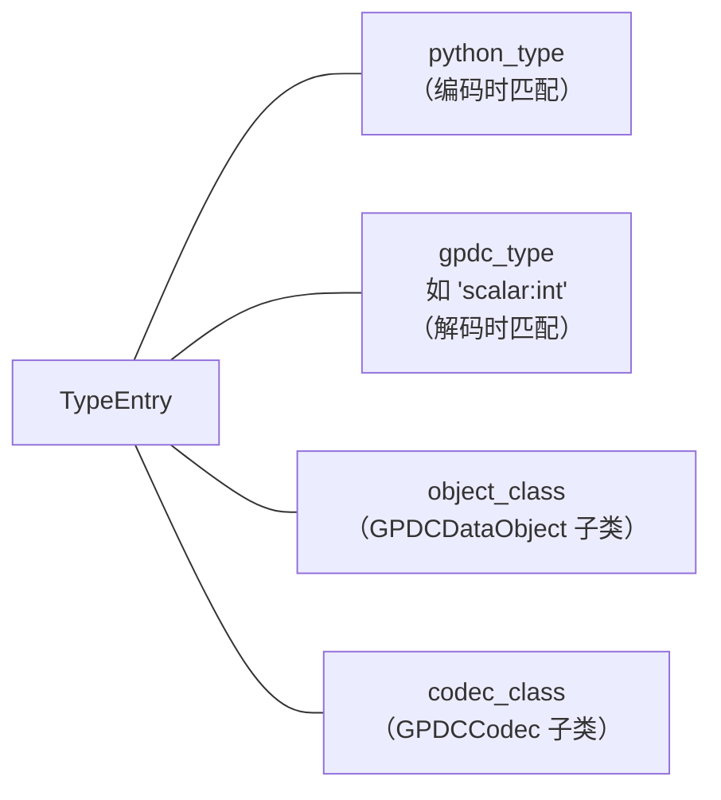
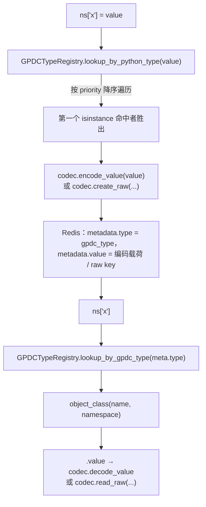
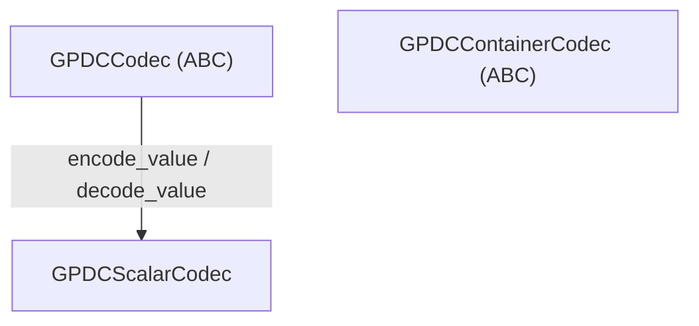
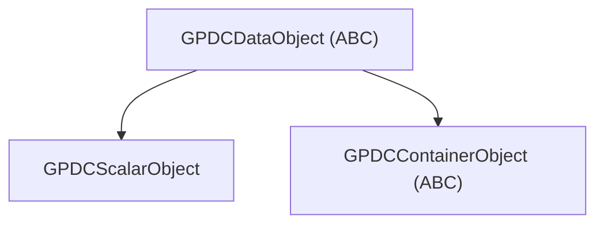

# 可扩展性

本文阐述 `gpdatacached` 的类型系统如何工作，以及如何通过编写 codec、对象类并注册它们，来**为你自己的类型**添加支持 —— 包括标量与容器两种。内建的标量类型（`int`、`str` …）、容器类型（`list`、`dict`、`set`）以及可选扩展（pydantic、pandas）全都构建在本文所描述的同一套公开机制之上。
> **你需要读这份文档吗？** 对绝大多数用户和绝大多数场景而言，GPDC 的内建类型 —— 加上自带的 [Pydantic](./pydantic-support.md) 与 [Pandas](./pandas-support.md) 扩展 —— 就已经够用了。即使确实需要自定义类型，扩展一个**标量**类型、或一个**扁平（元素不嵌套容器）的容器**类型，就能满足大多数现实中的扩展需求，而且这两者写起来相对简单。只有当你需要扩展的类型足够复杂（量级类似 `pandas.Series` / `pandas.DataFrame`）时，才需要用到本文档描述的完整机制；这种情况下，请仔细通读本文档，**并**同时研读[生命周期管理](./lifecycle.md)、[多进程加锁](./locking.md) 与[性能指南](./performance-guide.md) —— 把一个复杂类型做对，需要对 GPDC 有相当全面的认知，否则很容易引入难以察觉的 bug。

---

## 1. 类型系统概览

GPDC 存储的每个 Python 值都由一个 **`TypeEntry`** 描述 —— 一条把四样东西链到一起的不可变记录：



所有条目都存放在一个全局、线程安全的注册表中：**`GPDCTypeRegistry`**。两个方向的查找都经过它：

- **编码**（`ns["x"] = value`）→ `lookup_by_python_type(value)` 找到其 `python_type` 能匹配 `value` 的条目。
- **解码**（读取回来）→ 存储的 GPDC 类型字符串通过 `lookup_by_gpdc_type` 选中条目。

存在两种值族，契约不同：

| 族 | 存储形式 | Codec 基类 | 对象基类 | 示例 |
|---|---|---|---|---|
| **标量（scalar）** | 单个编码字符串，存于对象元信息 hash 内 | `GPDCScalarCodec` | `GPDCScalarObject` | `int`、`str`、`datetime`、`tuple`、`None` |
| **容器（container）** | 元素数据存放在独立的 Redis key（`raw:`）中 | `GPDCContainerCodec` | `GPDCContainerObject` | `list`、`dict`、`set` |

> 注意：`tuple` 被注册为**标量**（一种以单个 JSON 字符串存储的“复合标量”），而非容器。某个类型是标量还是容器，是你在注册时做出的设计选择 —— 见 [§4](#4-codec)。

---

## 2. 注册条目

注册一个类型，永远是通过一次调用把四样东西配对：

```python
from gpdatacached import GPDCTypeRegistry

GPDCTypeRegistry.register(
    python_type=MyType,                 # 此条目匹配的 Python 类
    gpdc_type="scalar:mytype",          # 唯一的 GPDC 类型字符串（形如 "family:name"）
    object_class=MyObject,              # GPDCScalarObject / GPDCContainerObject 子类
    codec_class=MyCodec,                # GPDCScalarCodec / GPDCContainerCodec 子类
    priority=0,                         # 歧义 Python 类型的决胜规则（高者胜）
)
```

这四个字段直接映射到一个 `TypeEntry`。两条不变量必须满足：

1. **`object_class.TYPE` 必须等于 `gpdc_type`。** 对象类通过其 `TYPE` 类属性标识自己，若干内部路径（尤其是解码）会交叉校验两者。
2. **`gpdc_type` 必须全局唯一。** 用同一个 `gpdc_type` 重复注册会替换前一条目（幂等），但两个不同的 Python 类型不能共用同一个 `gpdc_type`。

`TypeEntry` 还暴露一个派生布尔属性 `is_container`（当 `object_class` 是 `GPDCContainerObject` 子类时为真）；你选择的 codec/对象基类决定了它。

---

## 3. 类型解析：编码 vs 解码



### 优先级规则

注册表按 **`priority` 降序**遍历条目，返回第一个其 `python_type` 能通过 `isinstance` 匹配 `value` 的条目。这一点在你自定义的类型**子类化了某个已注册类型**时至关重要。内建类型就依赖它：`bool` 以 `priority=10` 注册，`int` 以 `priority=0` 注册，因此 `True` 会优先命中 `bool`（否则会被错误地路由到 `int`，因为 `bool` 是 `int` 的子类）。见 [§8](#extend-priority)。

---

## 4. Codec 契约

三个抽象基类构成 codec 层级：



两个**相互独立**的根：`GPDCCodec`（标量）与 `GPDCContainerCodec`（容器）是兄弟关系 —— 容器 codec 永远不实现 `encode_value`/`decode_value`。

### `GPDCCodec` —— 根 ABC

```python
class GPDCCodec(ABC):
    @classmethod
    @abstractmethod
    def encode_value(cls, value: object) -> str: ...
    @classmethod
    @abstractmethod
    def decode_value(cls, encoded: str) -> object: ...
```

你永远不会直接继承它 —— 从下面两个特化基类中选一个。

### `GPDCScalarCodec` —— 用于标量

```python
class GPDCScalarCodec(GPDCCodec):
    @classmethod
    def _parse_encoded(cls, encoded: str) -> tuple[str, str]:
        # 把 "type_prefix:payload" 拆成 (prefix, payload)。格式错误时抛 ValueError。
        ...
```

标量 codec 实现 `encode_value` / `decode_value`。约定：编码形式以一个**类型前缀**加冒号开头：`"int:42"`、`"str:hello"`、`"color:10,20,30"`。共享的 `_parse_encoded` 辅助方法会在解码时为你按第一个冒号拆分。

编码后的字符串**直接存放在对象元信息 hash 的 `value` 字段中**。不使用 raw key。

### `GPDCContainerCodec` —— 用于容器

```python
class GPDCContainerCodec(ABC):
    @classmethod
    @abstractmethod
    def create_raw(cls, namespace, raw_key: str, value: object,
                   owner_name: str, cache_mode: str, ttl: int) -> None: ...
    @classmethod
    @abstractmethod
    def read_raw(cls, namespace, raw_key: str) -> object: ...
    @classmethod
    @abstractmethod
    def delete_raw(cls, namespace, raw_key: str) -> None: ...
```

容器 codec **不使用** `encode_value`/`decode_value`。它拥有一个独立的 Redis key（`raw_key`），知道如何把值在 Redis 中铺开、并重建回来：

| 方法 | 何时调用 | 你需要做什么 |
|---|---|---|
| `create_raw(namespace, raw_key, value, owner_name, cache_mode, ttl)` | 首次存储 / 整体覆盖时 | 把 `value` 的元素写入 `raw_key`（LIST/HASH/SET/…）。元素用 encode 辅助函数处理。 |
| `read_raw(namespace, raw_key) -> object` | 在 `.value` 读取时 | 从 Redis 重构并返回一个普通 Python 对象。 |
| `delete_raw(namespace, raw_key)` | 重新创建前，以及拆解时 | 删除 raw key。 |

`namespace` 参数提供 `namespace._redis()`（Redis 客户端）以及 `namespace.domain.name` / `namespace.name`（用于构造 key）。`owner_name`、`cache_mode`、`ttl` 被透传，以便嵌套元素编码（见 [§10](#10-vs)）能应用正确的策略。

---

## 5. 对象类契约

对象类是薄薄的包装，把一个 Redis key 绑定到一个面向 Python 的 API。同样是三个 ABC：



### `GPDCDataObject` —— 根 ABC

提供身份（`name`、`namespace`、`domain`、`uri`、`canonical_name`）、元信息访问（`meta`、`cache_mode`、`ttl`、`created_at`、`updated_at`）、生命周期方法（`expire_in`、`persist` …）以及加锁（`lock()`、`try_lock()`）。这些全部免费继承。

### `GPDCScalarObject` —— 用于标量

子类设置一个类属性，并继承 value 的 getter/setter：

```python
class MyObject(GPDCScalarObject):
    TYPE = "scalar:mytype"
```

- `.value` getter 加载元信息，通过 `TYPE` 查找 codec，调用 `decode_value`。
- `.value` setter 针对已注册的 `python_type` 做类型检查，通过 `encode_value` 编码，写入元信息，并在 `cache_mode == "sliding"` 时刷新 TTL。

你几乎永远不需要重写其他东西。

### `GPDCContainerObject` —— 用于容器

子类混入一个 `collections.abc` 接口（`MutableSequence`、`MutableMapping` 或 `MutableSet`），在 `self.raw_key` 之上实现其抽象方法。你必须提供：

- 一个 `TYPE = "collection:mytype"` 类属性。
- 一个 `type` 属性，返回 `cls.TYPE`。
- 一个 `value` 属性（通过 `read_raw` 解码）**以及**一个 `value` setter，后者调用 `self._reject_value_replacement()` —— 容器通过其显式方法变更，不能重新赋值。
- 所混入 ABC 的全部抽象方法（`__getitem__`、`__setitem__`、`__delitem__`、`__len__`、`__iter__`、`insert` …）。
- 一个 `deepcopy()` 方法。

你继承 `_touch()`、引用追踪辅助（`_release_element_ref`、`_data_owner_name`、`referrers()`）以及 encode/decode 辅助 —— 它们是 [§11](#extend-mutation-hooks) 的积木。

!!! note "你的 `__getitem__` 还有第二个调用者：URI 遍历"

    [`GPDataCache.get_object_by_uri`](./api.md#get_object_by_uri) 会通过 `__getitem__` 逐段深入一个容器。对自定义容器而言有两点影响：

    - 遍历只对 `ListObject` 把分段**强转**为 `int`；其他所有容器收到的都是原始的**字符串**分段。如果你的容器需要非字符串 key，它就无法通过 URI 路径分段到达（分段会以字符串形式到达）。
    - 遍历返回的是**对象，绝不是值**。如果你的 `__getitem__` 返回原生 Python 值（正如内建 `DictObject`/`ListObject` 对标量元素所做的那样），那么终止于此处的 URI 会抛出 `ObjectNotFoundByURIError`。这是有意为之 —— 与 `__getitem__` 对标量元素返回原生值的行为保持一致。

---

## 6. 四步扩展配方

每一个扩展，无论多复杂，都归结为四步：

1. **选定值族。** 标量 = 存一个值；容器 = 把元素存进 Redis。
2. **编写 codec**（`GPDCScalarCodec` 或 `GPDCContainerCodec`）。
3. **编写对象类**（`GPDCScalarObject` 或 `GPDCContainerObject`），其 `TYPE` 与你将注册的 GPDC 类型一致。
4. **注册**：用 `GPDCTypeRegistry.register(...)`，选择一个 `priority`，使其压过任何已注册的父类。

接下来的章节用完整、可运行的示例分别走通两个值族。

---

## 7. 完整示例：自定义标量类型（`Color`）

目标：缓存一个 RGB `Color` 值。它小巧、不可变、原子 —— 非常适合**标量模式**。

### 第 1 步 —— Python 类型

```python
from dataclasses import dataclass

@dataclass(frozen=True)
class Color:
    r: int
    g: int
    b: int
```

### 第 2 步 —— codec

标量 codec 编码为 `prefix:payload` 字符串并解码回来。前缀必须与 GPDC 类型中 `scalar:` 之后的部分一致。

```python
from gpdatacached import GPDCScalarCodec

class ColorCodec(GPDCScalarCodec):
    @classmethod
    def encode_value(cls, value: object) -> str:
        # 始终显式校验输入类型 —— 不要依赖鸭子类型。
        if not isinstance(value, Color):
            raise TypeError(f"ColorCodec cannot encode {type(value).__name__!r}")
        # 约定："prefix:payload"。保持载荷对 Redis hash 安全（不要有会干扰
        # _parse_encoded 的多余冒号 —— 它按第一个冒号拆分）。
        return f"color:{value.r},{value.g},{value.b}"

    @classmethod
    def decode_value(cls, encoded: str) -> object:
        # _parse_encoded 返回 (prefix, payload)，格式错误时抛 ValueError。
        prefix, payload = cls._parse_encoded(encoded)
        if prefix != "color":
            raise ValueError(f"ColorCodec cannot decode type {prefix!r}")
        try:
            r, g, b = (int(x) for x in payload.split(","))
        except ValueError as e:
            raise ValueError(f"Invalid color payload: {payload!r}") from e
        return Color(r, g, b)
```

有两点需要注意：

- **编码时显式做类型检查。** codec 可能被任何东西调用；尽早拒绝能给出清晰错误。
- **`_parse_encoded` 按第一个冒号拆分。** 如果你的载荷本身含冒号（如 ISO datetime），没问题 —— 只拆第一个。

### 第 3 步 —— 对象类

对标量而言，这是一行：

```python
from gpdatacached import GPDCScalarObject

class ColorObject(GPDCScalarObject):
    TYPE = "scalar:color"   # 必须与你注册的 gpdc_type 一致
```

### 第 4 步 —— 注册并使用

```python
from gpdatacached import GPDCTypeRegistry, GPDCDomain, GPDCDomainConfig

GPDCTypeRegistry.register(
    python_type=Color,
    gpdc_type="scalar:color",
    object_class=ColorObject,
    codec_class=ColorCodec,
    priority=0,
)

domain = GPDCDomain(GPDCDomainConfig(redis_host="127.0.0.1", redis_port=6379), name="app")
ns = domain.ensure_namespace("ui")

ns["background"] = Color(10, 20, 30)
assert ns["background"] == Color(10, 20, 30)   # 读回来是原生 Color

# 它自动与一切组合。
ns["palette"] = [Color(255, 0, 0), Color(0, 255, 0)]   # 嵌入 list
ns["theme"] = {"bg": Color(0, 0, 0)}                   # 嵌入 dict
ns.get_object("background").update_cache_mode_and_ttl("ttl", 60)  # 生命周期可用
```

当你的类型作为 list/dict 元素或 tuple 成员出现时，codec 也会被自动调用 —— 你不需要教容器认识 `Color`。

---

## 8. 优先级的实际用法：子类关系 { #extend-priority }

注册表通过 `isinstance` 匹配，并按 `priority` 降序排序。每当你的类型**子类化了某个已注册类型**时，这一点都**至关重要**。

```python
import enum

class Status(enum.IntEnum):
    ACTIVE = 1
    INACTIVE = 2
    DISABLED = 3
```

`Status` 是 `int` 的子类，而 `int` 已经以 `priority=0` 注册。如果你也以 `priority=0` 注册 `Status`，注册表中的顺序就不稳定，`Status.ACTIVE` 可能先命中普通 `int` 条目 —— 被存成 `"int:1"` 并丢失枚举身份。修正方法是给一个更高的优先级：

```python
GPDCTypeRegistry.register(
    python_type=Status,
    gpdc_type="scalar:status",
    object_class=StatusObject,
    codec_class=StatusCodec,
    priority=10,          # 压过 int（priority 0）—— 先被检查
)
```

**经验法则：** 如果你的类型满足 `isinstance(x, 某已注册类型)` 为 `True`，就把你的 `priority` 设得比那个类型高。

---

## 9. 完整示例：自定义容器类型（`Counter`）

目标：缓存一个 `collections.Counter`（多重集）。这是一个**容器** —— 它有可变数量的成员，我们希望能就地变更。我们用 Redis HASH 作为后端：`{encoded_member: count_string}`。

### 第 1 步 —— Python 类型

```python
from collections import Counter
```

`Counter` 是 `dict` 的子类 —— 因此我们需要 `priority > 0` 才能在 `dict` 之前被匹配（见 [§8](#extend-priority)）。

### 第 2 步 —— codec

```python
from gpdatacached import GPDCContainerCodec
from gpdatacached.types import encode_key, decode_key

class CounterCodec(GPDCContainerCodec):
    """把 Counter 存为 Redis HASH：encoded_member → count 字符串。"""

    @classmethod
    def create_raw(cls, namespace, raw_key, value, owner_name, cache_mode, ttl) -> None:
        if not value:
            return
        # 成员是可哈希标量 —— encode_key 把每个成员规范化为
        # "prefix:payload" 形式，使 hash 字段名无歧义。
        mapping = {encode_key(member): str(count) for member, count in value.items()}
        namespace._redis().hset(raw_key, mapping=mapping)

    @classmethod
    def read_raw(cls, namespace, raw_key) -> Counter:
        data = namespace._redis().hgetall(raw_key)
        if not data:
            return Counter()
        return Counter({decode_key(k): int(v) for k, v in data.items()})

    @classmethod
    def delete_raw(cls, namespace, raw_key) -> None:
        namespace._redis().delete(raw_key)
```

说明：

- 成员是**标量**，所以我们用 `encode_key` / `decode_key`（键编码辅助）。对于元素本身可能是容器的情形，应改用 `encode_element` / `decode_element` —— 见 [§10](#10-vs)。
- 计数以普通十进制字符串存储。它们是标量，但我们内联存储，而非把 `int` 注册为“计数”，因为计数的含义仅对本容器局部有效。
- `value` 为空时 `create_raw` 是空操作 —— GPDC 让 raw key 不存在，`read_raw` 返回空 `Counter`。

### 第 3 步 —— 对象类

我们混入 `MutableMapping`，用户就能免费获得 `keys()`、`values()`、`items()`、`get()`、`setdefault()`、`update()` 与 `pop()`。我们直接在 `self.raw_key` 上实现四个抽象方法。

```python
import collections.abc
from collections import Counter
from gpdatacached import GPDCContainerObject
from gpdatacached.types import encode_key, decode_key

class CounterObject(GPDCContainerObject, collections.abc.MutableMapping):
    TYPE = "collection:counter"

    @property
    def type(self) -> str:
        return self.TYPE

    @property
    def value(self) -> Counter:
        return CounterCodec.read_raw(self._namespace, self.raw_key)

    @value.setter
    def value(self, new_value):
        # 容器不能被重新赋值 —— 请通过 __setitem__ 等方法变更。
        self._reject_value_replacement()

    def __len__(self) -> int:
        return self._redis().hlen(self.raw_key)

    def __getitem__(self, key):
        encoded = encode_key(key)
        raw = self._redis().hget(self.raw_key, encoded)
        if raw is None:
            raise KeyError(key)
        return int(raw)

    def __setitem__(self, key, count):
        if not isinstance(count, int) or count < 0:
            raise ValueError("Counter values must be non-negative ints")
        encoded = encode_key(key)
        r = self._redis()
        if count == 0:
            r.hdel(self.raw_key, encoded)
        else:
            r.hset(self.raw_key, encoded, str(count))
        self._touch()                  # 刷新滑动 TTL + updated_at（见 §11）

    def __delitem__(self, key):
        encoded = encode_key(key)
        if not self._redis().hdel(self.raw_key, encoded):
            raise KeyError(key)
        self._touch()

    def __iter__(self):
        for encoded in self._redis().hkeys(self.raw_key):
            yield decode_key(encoded)

    def deepcopy(self) -> Counter:
        return Counter(self.value)
```

### 第 4 步 —— 注册并使用

```python
from gpdatacached import GPDCTypeRegistry, GPDCDomain, GPDCDomainConfig

GPDCTypeRegistry.register(
    python_type=Counter,
    gpdc_type="collection:counter",
    object_class=CounterObject,
    codec_class=CounterCodec,
    priority=10,          # Counter 是 dict 子类 → 必须压过 dict（priority 0）
)

domain = GPDCDomain(GPDCDomainConfig(redis_host="127.0.0.1", redis_port=6379), name="counterapp")
ns = domain.ensure_namespace("words")

ns["word_counts"] = Counter({"hello": 3, "world": 1})
counts = ns["word_counts"]            # → CounterObject（活跃）
counts["hello"] += 1                  # 就地变更，直接命中 Redis
assert counts["hello"] == 4
del counts["world"]
assert "world" not in counts
```

因为我们混入了 `MutableMapping`，你还免费获得 `counts.update(...)`、`counts.get(k, default)`、`counts.pop(k)`，以及（在用 `.value` 物化后）`counts.most_common()`。

---

## 10. 元素编码：标量成员 vs 嵌套容器

`Counter` 示例使用 `encode_key` / `decode_key`，因为其成员是**可哈希标量**。如果你的容器可以容纳**嵌套容器**作为元素（如内建的 `list` / `dict`），就必须改用 `encode_element` / `decode_element` —— 对任何容器值，它们会发出 `ref:{obj_key}` 指针，并惰性地把容器物化为匿名 GPDC 对象。

| 辅助函数 | 使用时机 | 输出 |
|---|---|---|
| `encode_key(value)` / `decode_key(encoded)` | 可哈希标量元素（dict 键、set 成员、本例 Counter 的成员） | 始终是 `prefix:payload` 字符串；拒绝容器和空元组 |
| `encode_element(value, namespace, owner_name, policy)` / `decode_element(encoded, namespace)` | 元素**既可能**是标量**也可能**是容器 | 一个标量编码字符串，**或**一个解析为活跃 `GPDCContainerObject` 的 `ref:{obj_key}` 指针 |

例如，内建 `DictCodec` 对键（始终标量）使用 `encode_key`，但对值（可能是嵌套 list/dict/set）使用 `encode_element`。内建 `ListCodec` 对每个元素都用 `encode_element`。当你移除或覆盖一个后来发现是 `ref:` 指针的元素时，必须调用 `self._release_element_ref(old_encoded)`，以便递减匿名子对象的引用者计数（并在最后一个引用者消失时级联删除） —— 见 [§11](#extend-mutation-hooks)。

当 `create_raw` 在一次调用中编码**多个兄弟元素**时，请用 **`encode_session`** 上下文管理器包裹编码循环。它提供循环检测与回滚：编码中途失败时，会删除本次调用期间创建的所有匿名对象，并逆转其对既有容器所做的引用计数增量——编码路径的写入会被还原。（注意：`encode_session` 只管辖编码路径本身。如果你的 `create_raw` 在编码之前有任何写入——例如 pandas 在追加流水线之前提交的 RangeIndex→levels 索引表示提升——这些不在会话覆盖范围内，失败时仍保持已提交。请把编码前的写入排除在会话之外，或者接受失败的追加可能留下一个仅表示层面的变更。）

```python
from gpdatacached.types import encode_element, encode_session

@classmethod
def create_raw(cls, namespace, raw_key, value, owner_name, cache_mode, ttl):
    from gpdatacached.lifecycle import policy_from_defaults
    policy = policy_from_defaults(cache_mode, ttl)
    encoded_values = []
    with encode_session(namespace):           # 循环检测 + 回滚
        encoded_values = [encode_element(v, namespace, owner_name, policy) for v in value]
    if encoded_values:
        namespace._redis().rpush(raw_key, *encoded_values)
```

> 完整参考可研读 `src/gpdatacached/builtins/list_object.py` 与 `dict_object.py` —— 它们展示了针对嵌套容器型容器的完整 encode/decode/release 模式。

> ⚠️ **性能提示。** 每个嵌套容器都会成为独立的匿名对象，拥有自己的 key、引用追踪与 TTL。深嵌套会在存储、读取、sliding 刷新、级联删除上叠加此代价。何时该扁平化，见[性能指南 §4](./performance-guide.md#perf-nesting)。

---

## 11. 每个容器都必须调用的变更钩子 { #extend-mutation-hooks }

实现容器对象时，每一个变更 Redis 的方法都必须遵守三个钩子。漏掉任何一个都会产生微妙 bug（TTL 过期不刷新、匿名子对象泄漏、更新时间戳错误）。

### a) 每次变更后调用 `self._touch()`

`_touch()`（定义在 `GPDCContainerObject` 上）更新 `updated_at` 与 `item_count` 元信息；并且 —— 当对象自持且处于 `sliding` 模式时 —— 跨所属子树刷新 TTL。若对象被父对象拥有，则改为沿 owner 链向上传播刷新。

```python
def __setitem__(self, key, count):
    ...
    r.hset(self.raw_key, encoded, str(count))
    self._touch()          # ← 始终调用
```

### b) 移除 `ref:` 元素时调用 `self._release_element_ref(old_encoded)`

如果你的容器支持嵌套容器元素（通过 `encode_element`），移除或覆盖一个此类元素时必须递减匿名子对象的引用者计数：

```python
def __setitem__(self, key, value):
    encoded_key = encode_key(key)
    old = r.hget(self.raw_key, encoded_key)
    encoded_val = encode_element(value, self._namespace, self._data_owner_name(), policy)
    r.hset(self.raw_key, encoded_key, encoded_val)
    self._release_element_ref(old)   # ← 若旧值是 ref，则释放其引用
    self._touch()
```

`_release_element_ref` 对非 `ref:` 编码值是空操作，因此始终调用是安全的。

### c) 多元素编码时使用 `encode_session`

见 [§10](#10-vs)。单元素变更（`append`、单值 `__setitem__`）不需要 —— 编码路径内部会开启一个回退会话。

> 这些钩子参与的所有权与引用计数模型，完整说明见[生命周期管理](./lifecycle.md)。

---

## 12. 注册检查清单与陷阱

发布扩展前，逐条对照：

- [ ] `object_class.TYPE == gpdc_type`（完全相等）。
- [ ] `gpdc_type` 全局唯一 —— 不确定时用模块前缀（`scalar:mymodule_color`）。
- [ ] `python_type` 是用户将传入的确切类；若它是某已注册类型的子类，`priority` 要高于该类型。
- [ ] 标量 codec 始终在 `encode_value` 中做类型检查，并在 `decode_value` 中校验前缀。
- [ ] 容器 codec 实现了 `create_raw`、`read_raw`、`delete_raw` 全部三个。
- [ ] 容器对象实现了所混入 ABC 的每个抽象方法，外加 `value`（getter + 调用 `_reject_value_replacement` 的 setter）、`type`、`deepcopy`。
- [ ] 每个变更都调用 `self._touch()`。
- [ ] 移除/覆盖可能是 `ref:` 的元素时调用 `self._release_element_ref(old)`。
- [ ] 多元素编码用 `encode_session` 包裹。
- [ ] `register()` 在进程启动时调用一次，且在任何涉及该类型的读写之前。

**陷阱：**

- **子类忘记设 `priority`。** 你的类型会被父类的 codec 静默编码，解码时变成父类。务必检查：我的类型是否对某个已注册类型 `isinstance` 为真？是，就提高 priority。
- **`prefix:` 中含冒号。** `_parse_encoded` 按**第一个**冒号拆分。载荷可以自由含冒号；前缀不能。
- **对容器重新赋值 `.value`。** setter 必须调用 `_reject_value_replacement()`。容器只能通过其显式方法改变形态。
- **首次使用后才注册。** 注册表是进程级且可变的，但 Redis 中以旧 `gpdc_type` 存储的对象不会迁移。请在启动时注册。
- **容器元素类型限制。** `encode_key` 拒绝容器和空元组（不可哈希 / 有歧义）。`encode_element` 接受标量与容器，但遇到自引用会抛 `CyclicReferenceError`。

---

## 13. 内建扩展

库自带两个可选扩展，都构建在本文描述的同一公开 API 之上：

| 扩展 | 值族 | 模式 | 说明 |
|---|---|---|---|
| [`pydantic_support`](./pydantic-support.md) | 标量**与**容器 | 按模型注册：薄对象子类 + `PydanticModelScalarCodec`（标量模式）或 `PydanticModelContainerCodec` + `BaseModelContainerObject`（容器模式） | 让你缓存 pydantic `BaseModel` 记录，可选字段级访问。 |
| [`pandas_support`](./pandas-support.md) | 容器 | 一次 `register()` 同时注册 `Series` 与 `DataFrame` | 把 pandas 结构缓存为活跃对象，带选择性在线访问器。 |

阅读其源码（`src/gpdatacached/extensions/`）是看清完整 codec/对象模式如何应用于非平凡类型的最佳途径。

---

## 延伸阅读

- **[总体概览](./overview.md)** —— 类型系统在整体架构中的位置（§3、§7）。
- **[API 参考](./api.md)** —— `GPDCTypeRegistry`、codec ABC、对象 ABC 的完整签名。
- **[生命周期管理](./lifecycle.md)** —— 你的容器变更钩子所参与的所有权与引用计数模型。
- **[Pydantic 支持](./pydantic-support.md)** · **[Pandas 支持](./pandas-support.md)** —— 非平凡扩展的实战示例。
