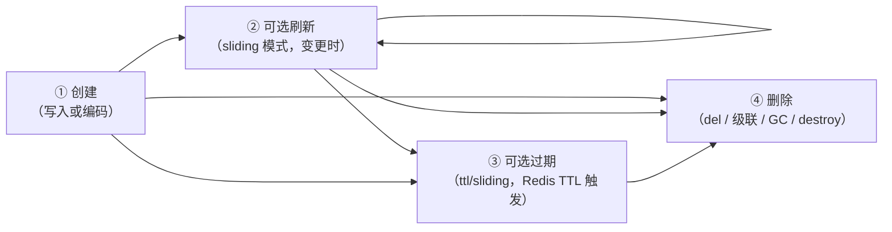
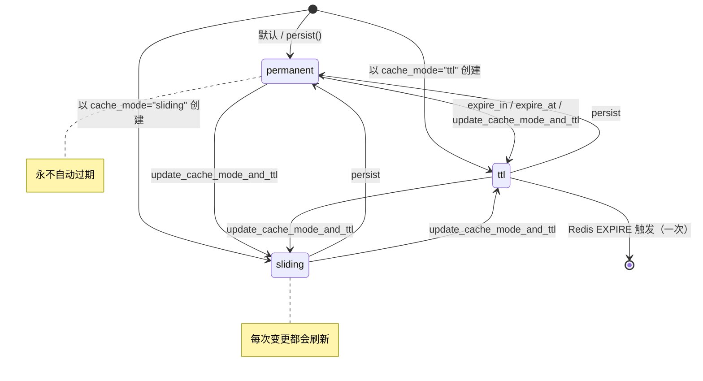
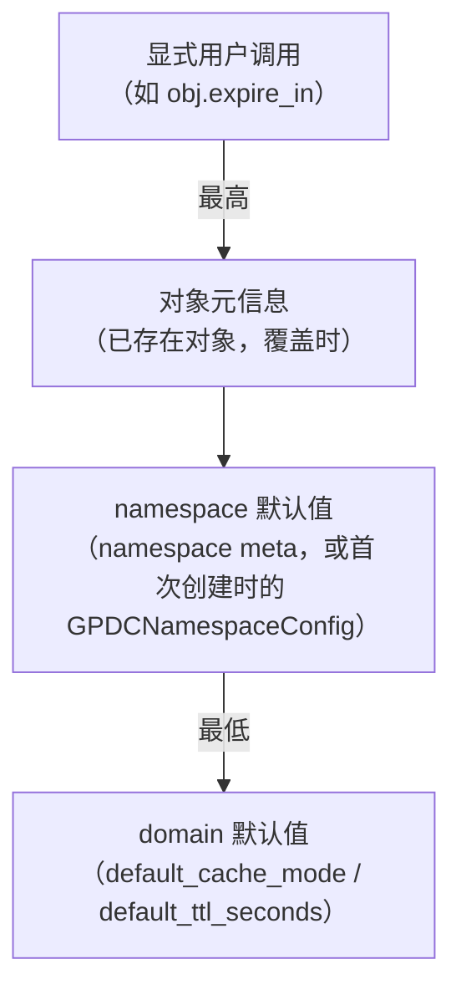
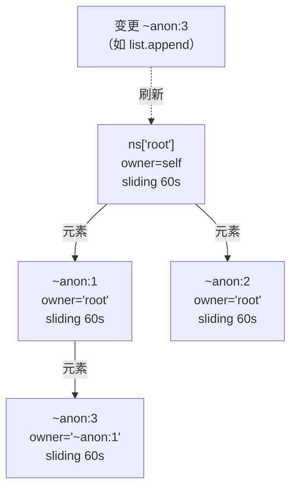
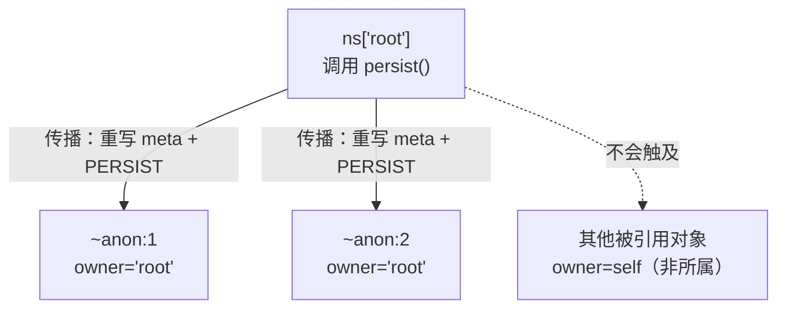
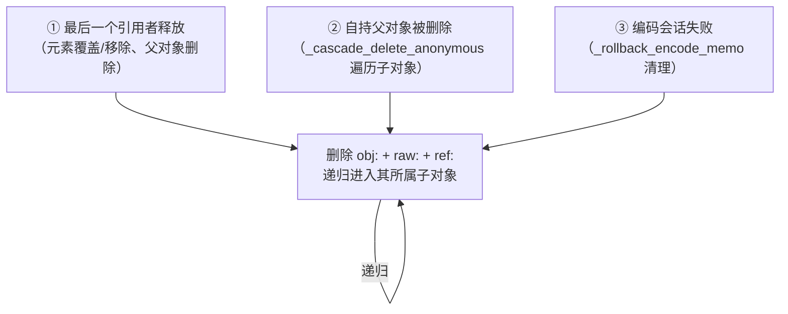

# 生命周期管理

本文描述 `gpdatacached` 如何管理数据对象的生命周期 —— **创建、过期与删除** —— 包括**匿名对象**与**引用对象**的生命周期，它们的行为与具名 owner 对象有所不同。

大多数用户永远无需手动管理生命周期。本文的目的，是让你对对象何时出现、刷新、过期、消失拥有**合理的预期**，使本库的自动行为不会让你困惑。

## 1. 此处的“生命周期”指什么

GPDC 对象的生命周期包含四个阶段：



GPDC 为你自动处理 **①②③**。只有当你想要**改变**某个对象的策略（让永久对象过期、让 ttl 对象永久化等），或需要显式**删除**某个对象时，才会直接接触生命周期。最容易让用户困惑的，是**匿名对象与引用对象如何进入和离开这些阶段** —— [§8](#8) 与 [§9](#9) 会详述。

---

## 2. 策略模型

每个对象都携带一份 `(cache_mode, ttl)` **策略**，作为 `cache_mode` 与 `ttl` 字段存放在其元信息 hash 中。

| `cache_mode` | `ttl` | 语义 |
|---|---|---|
| `permanent` | `0` | 永不过期。会调用 Redis `PERSIST`。这是**默认值**。 |
| `ttl` | `> 0` | **固定过期**：对象在创建或上次策略变更后 `ttl` 秒时消失一次。变更**不会**刷新计时器。 |
| `sliding` | `> 0` | **滑动窗口**：每次变更都把 TTL 重置为 `ttl` 秒。只要持续被触碰，对象就一直存活。 |

### 状态迁移



### 校验规则

策略会被严格校验：

- `permanent` 接受任何 `ttl >= 0`（该值会被静默忽略 —— 会调用 Redis `PERSIST`，因此对象永不过期）。
- `ttl` 与 `sliding` 要求 `ttl > 0`。
- `ttl` 永远不能为负。

违反时会在策略构造时（`policy_from_defaults`）抛出 `ValueError`，因此无效策略永远写不进 Redis。

---

## 3. 策略来源：默认值从何而来

创建**新**对象时，初始策略按如下优先级解析：



1. **显式用户调用** —— `expire_in`、`expire_at`、`persist`、`update_cache_mode_and_ttl`。始终胜出。
2. **对象元信息** —— 对**已存在的标量被原地覆盖**的情形，会保留前一份策略（见下方注意事项）。
3. **namespace 默认值** —— 存放在 namespace meta hash 中。namespace 首次创建时，这些值来自 `GPDCNamespaceConfig`（若设置了字段）；否则继承自 domain。
4. **domain 默认值** —— `GPDCDomainConfig.default_cache_mode`（默认 `"permanent"`）与 `default_ttl_seconds`（默认 `0`）。

> ⚠️ **覆盖注意事项。** 只有**标量覆盖标量**才会保留前一份策略。**覆盖容器**（把旧的拆掉重新创建）与**替换引用绑定**都会把策略重置为 namespace 默认值。若重新写入的容器需要特定策略，请在写入后显式设置。

---

## 4. TTL 应用语义

当 GPDC 对对象应用策略时，会遍历该对象的 Redis key，执行 `PERSIST`（不过期）**或** `EXPIRE`（带 `ttl` 秒）：

| 策略 | 每个 key 的 Redis 调用 | 效果 |
|---|---|---|
| `permanent` | `PERSIST key` | 剥离任何已存在的 TTL。key 存活直到被显式删除。 |
| `ttl` | `EXPIRE key ttl` | key 在距今 `ttl` 秒后消失一次。 |
| `sliding` | `EXPIRE key ttl` | 与 `ttl` 相同，但每次变更都会重新应用。 |

### 哪些 key 会被应用 TTL？

| 对象类型 | 被 TTL 触及的 key |
|---|---|
| 标量 | `obj:{name}`（元信息 hash，也持有编码后的值） |
| 容器（canonical owner） | `obj:{name}` + `raw:{name}` + `ref:{name}`（三者共享对象的 TTL） |

这就是为什么容器的元信息、原始数据、引用者集合总是一起消失 —— 它们共用一个 TTL 时钟。引用（别名）绑定作为普通 Redis 字符串 key 存储，创建时**不应用 TTL** —— 别名会一直存在，直到被显式删除。通过引用调用的生命周期方法（如 `expire_in`、`persist`）作用于 **canonical owner**，而非别名绑定本身。

---

## 5. 滑动窗口刷新

`sliding` 模式让 GPDC 适合用作“在使用时保持活跃”的缓存。每次变更都会重新应用 TTL。

### 什么算作变更？

| 触发点 | 位置 | 刷新行为 |
|---|---|---|
| 标量 `value = x` setter | `GPDCScalarObject.value.fset` | 若 `cache_mode == "sliding"` 且 `ttl > 0`，调用 `refresh_ttl()`。 |
| 任何容器变更方法（`append`、`__setitem__`、`extend`、`pop` …） | `GPDCContainerObject._touch()` | 更新 `updated_at`/`item_count`，然后刷新 TTL —— 容器自身（若自持）或沿 owner 链向上传播。 |

非变更的**读取**永远不会刷新 TTL。滑动刷新严格绑定在写入上。

### 沿 owner 链向上传播

当某个匿名子对象被变更时，刷新它自己的 TTL 没有意义 —— 它的生命周期本就被父对象的生命周期所约束。因此 GPDC **沿 owner 链向上**，刷新**第一个自持祖先**（最终拥有该子树的那个具名对象）的 TTL：



变更 `~anon:3` 会走 `~anon:3 → ~anon:1 → root`，发现 `root` 自持，刷新 **root** 的 TTL。只要任何后代被触碰，整棵子树都会保持存活。

### 向下刷新所属子对象

刷新祖先之后，GPDC 还会把每个所属子对象**自身**策略的 TTL 重新应用到该子对象的 key（不重写元信息）。策略声明无过期（`permanent`，或 `ttl/sliding` 但 `ttl=0`）的子对象不会被改动，但递归仍会下钻，让更深的后代被触及。

> ⚠️ **性能提示。** 由于滑动刷新会在每次变更时遍历整个所属子树，单次写入开销为 O(子树大小)。对大型或高抖动容器而言，这是 GPDC 中最昂贵的生命周期代价。何时该用、何时不该用 sliding 模式，见[性能指南 §3](./performance-guide.md#3-sliding-ttl)。

---

## 6. 手动变更策略与级联传播

你很少需要在生命周期中途变更策略，但当你这么做时，GPDC 会把变更传播到所属子树。

### 面向用户的变更方法

| 方法 | 效果 | 权限 |
|---|---|---|
| `expire_in(seconds)` | 设置新 TTL。要求已处于 `cache_mode == "ttl"` 且 `seconds > 0`。要立即删除请用 `expire_now()`。 | 仅 owner。 |
| `expire_at(when)` | 设置绝对过期时间。要求 `cache_mode == "ttl"`。若 `when` 已过去则立即删除（等价于 `del ns[name]`：完整拆卸含匿名子树；若仍被引用则抛出 `CanonicalObjectReferencedError` —— 可先用 `has_referrers()` 检查）。 | 仅 owner。 |
| `expire_now()` | 立即删除本对象（等价于 `del ns[canonical_name]`：完整拆卸含匿名子树；若仍被引用则抛出 `CanonicalObjectReferencedError`）。适用于任何 `cache_mode` —— 当你想要一个明确、与模式无关的"立即删除"入口时，用它而非 `expire_in(0)`/`expire_at(过去)`。 | 仅 owner。 |
| `persist()` | 切换为 `permanent` 且 `ttl=0`。 | 仅 owner。 |
| `update_cache_mode_and_ttl(mode, ttl)` | 用 `(mode, ttl)` 替换整个策略。 | 仅 owner。 |

四个策略变更方法（`expire_in`、`expire_at`、`persist`、`update_cache_mode_and_ttl`）在权限检查（见 [§7](#7-ownership)）后都委托给 `set_lifecycle(policy)`。`expire_now()` 是明确的"立即删除"入口 —— 它委托给 `del ns[canonical_name]`（完整拆卸），而非 `set_lifecycle`。

### 级联传播

当对象的策略真正发生变化时，GPDC 会：

1. 重写对象自身的元信息（`cache_mode`、`ttl`、`updated_at`）。
2. 重新应用对象自身 key 的 TTL。
3. 递归遍历**所属子树**，对每个当前策略不同的所属子对象，重写其元信息并重新应用其 key 的 TTL。

遍历以 `owner == parent_name` 为界：只下钻**被当前父对象拥有**的子对象（而非任意嵌套引用）。某一子树层级的所有元信息重写与 TTL 应用会批量进同一条 Redis 流水线。



> 传播只改变**策略**与 **TTL**，永不改变数据。对活跃对象调用是安全的。

---

## 7. Ownership（所有者）模型

每个对象在元信息中有一个 `owner` 字段。所有权决定谁能控制对象的生命周期，也是匿名对象运作的核心。

| `owner` 值 | 含义 | 谁能变更生命周期？ |
|---|---|---|
| 等于对象自身的 canonical name | **自持（self-owned）**（一个具名 owner 对象）。 | 任何进程。对象是自己的主人。 |
| 等于其他某个名字 | **被该父对象拥有**（通常是编码期间创建的匿名子对象）。 | 仅父对象（或递归地，父对象的 owner）。 |

### 权限检查

四个生命周期变更方法（`expire_in`、`expire_at`、`persist`、`update_cache_mode_and_ttl`）都会调用 `_check_owner_permission`，当 `meta.owner` 非空且与 `self.canonical_name` 不同时抛出 `LifecyclePermissionError`。你不能直接变更匿名子对象的生命周期 —— 必须在拥有该子树的自持祖先上变更。

### `take_ownership()`

`take_ownership()` 的作用对象是**被引用的数据对象**，而不是引用（别名）绑定本身。它让**被引用对象**成为自己的 owner，从而可以独立管理自己的生命周期。

主要用例是**命名引用指向匿名嵌套对象**。匿名对象创建时 `owner = parent`（其生命周期依附于父容器）。当你持有一个指向它的命名引用时，`take_ownership()` 会把该匿名对象提升为自持 —— 它的 `owner` 从父对象名变为自己的 `~anon:…` canonical name：

```python
ns["parent"] = {"inner": [1, 2, 3]}          # inner 变为 ~anon:… ，owner 是 "parent"
inner = ns.get_object("parent")["inner"]      # 这个匿名 list 对象
ns["named"] = inner                           # 指向该匿名对象的命名引用
obj = ns.get_object("named")
obj.take_ownership()                          # 现在 ~anon:… 对象拥有自己；
                                             # owner = "~anon:…"，独立于 "parent"
# 此后 obj.update_cache_mode_and_ttl("ttl", 60) 给该 ~anon:… 对象设 TTL，
# 不会影响 "parent" —— 匿名对象现在有自己的生命周期。
```

**对命名（已自持）对象的引用调用 `take_ownership()` 是一个正确的 no-op。** 命名对象创建时就是自己的 owner，所以调用不改变任何东西 —— 这正是预期行为。在多进程共享环境里，调用者不一定是数据的创建者，也无法（也无需）知道被引用对象当初是匿名的还是命名的；调用者的意图 —— "让被引用对象自管生命周期" —— 对匿名对象是*被落实*，对命名对象则*已经满足*。两种情况下调用都合法。

调用本身必须**经由命名引用句柄**发起：`obj._is_reference` 必须为 `True`，且 `obj.name` 不能以 `~` 开头。在普通（非引用）对象上调用会抛 `TypeError`。

---

## 8. 匿名对象的生命周期

匿名对象是 GPDC 中**自动化程度最高**的部分。你永远不会直接创建或删除它们。理解它们的生命周期，能消除大多数“我的数据去哪了？”的困惑。

### 创建

匿名对象在**编码期间**创建，每当一个容器作为值**嵌套**存入另一个容器时：

```python
ns["matrix"] = [[1, 2], [3, 4]]      # 两个内层 list → 两个匿名对象
ns["nested"] = {"a": [1, 2, 3]}       # 这个 list 值 → 一个匿名对象
```

每个匿名对象会获得一个生成的名字（`~anon:{uuid}`）、自己的 `obj:`/`raw:`/`ref:` key、`owner` 设为**触发其创建的父名**，以及在父对象引用者集合（`ref:{anon}` → `{parent: count}`）中的一项。

> 匿名名是不可见的：`iter(ns)`、`len(ns)`、`key in ns` 以及（通过公开 API 的）`ns["~anon:..."]` 都会隐藏它们。它们只是嵌套数据的后端存储。

### 匿名对象的生命周期策略

匿名对象继承编码时生效的策略 —— 即创建时父容器的有效策略（在父上下文下计算的 `policy_from_defaults`）。创建之后，其生命周期由 **owner 链**驱动，而不仅靠自身策略：

- 对任一后代的 `sliding` 变更会刷新自持祖先的 TTL（见 [§5](#5)）。
- 对自持祖先的策略变更会向下传播到所属子对象（见 [§6](#6)）。

### 引用计数

每个匿名对象都有一个 `ref:` hash，映射**引用者名 → 槽位数**。同一父对象中的多个槽位可以指向同一匿名对象（例如同一个 list 在父 list 中出现两次），这就是计数可能大于 1 的原因。

### 级联删除触发条件

匿名对象会在以下三种情形之一被级联删除：



1. **最后一个引用者释放** —— 当引用该匿名对象的最后一个槽位被移除（元素被覆盖或 pop，或父对象自身被删除并遍历其子对象）。GPDC 检查 `has_referrers`；若为空且目标是匿名的，则级联。
2. **自持父对象被删除** —— `del ns["matrix"]` 删除父对象绑定，然后 `_cascade_delete_anonymous` 遍历父对象存储的原始数据，释放嵌套引用，并递归删除任何成为孤儿的匿名对象。
3. **编码会话回滚** —— 若异常从 `encode_session` 中传播出来（例如 `CyclicReferenceError`），本次会话期间创建的每个匿名对象都会被删除，不留孤儿匿名对象。（父容器自身的元信息 key 在编码会话开启之前写入，因此不会被这条路径回滚。）

### 重要后果

**GPDC 永远不会“泄漏”匿名对象。** 在三种级联触发与 GC（见 [§10](#10)）之间，失去所有引用者的匿名对象终会被回收。最坏情况是异常崩溃到下一次 GC 周期之间的一段短暂窗口。

---

## 9. 引用（别名）的生命周期

**引用**是一个具名绑定（`obj:alias` STRING 持有 `ref:{canonical_obj_key}`），指向某个 canonical owner。引用让多个名字可以共享同一份数据而无需拷贝。

### 创建

```python
ns["alias"] = ns["original"]   # 两个名字现在都解析到同一份 canonical 数据
```

这会写入一个 `obj:alias` 字符串 key，并把 `original` 的引用者计数加一。**不拷贝任何数据。** 引用绑定本身没有策略元信息，也没有应用 TTL —— 通过引用读取 `cache_mode`/`ttl` 返回的是 **canonical owner 的**策略，因为元信息是从 canonical key 加载的。

### 读取

读取会透明地跟随引用：`ns["alias"]` 解析指针并返回活跃容器，与 `ns["original"]` 完全一致。锁会解析到 canonical name，因此别名与 canonical owner 争用的是同一把锁。

### 删除

| 你删除… | 发生什么 |
|---|---|
| 别名（`del ns["alias"]`） | 移除 `obj:alias` 字符串 + canonical owner 引用计数减一。若 canonical owner 是匿名的且这是其最后一个引用者，则级联删除该匿名对象。 |
| 在存在别名时删除 canonical owner（`del ns["original"]`） | **抛出 `CanonicalObjectReferencedError`。** 你必须先删除别名。 |

这种保护是有意为之：静默删除其他名字仍指向的数据会是个陷阱。错误的 `.referrers` 字段会告诉你需要清理哪些绑定。

### 引用绑定自身的生命周期

引用的 `obj:alias` key **没有应用 TTL**；它会一直存在，直到被显式删除。在引用上调用的生命周期变更方法作用于 **canonical owner**，而非别名绑定 —— 使用 `take_ownership()`（见 [§7](#7-ownership)）可以把**被引用对象**提升为自持，从而携带自己的策略。

---

## 10. 垃圾回收

GPDC 的后台 GC 清理**孤儿** —— 对象过期或引用者抖动后残留的 key。它**不替代** [§8](#8) 中的级联删除逻辑；它是同步路径无法原子处理的情形的安全网：

- **TTL 过期**：当 `ttl`/`sliding` 对象的 Redis TTL 触发，它会消失，但引用者与引用者集合条目可能残留。
- **引用抖动**：覆盖/移除容器元素会留下过期的 `ref:` 条目。

### GC 做什么

当 `gc_enabled=True` 时，后台线程会按 `gc_interval_seconds` 的周期为每个 namespace 运行 `run_gc_for_namespace`。对每个 canonical name（在其自身的对象级锁下、按名字升序处理）：

1. **过期别名绑定** —— `obj:alias` 字符串指向的 `ref:` 目标已不存在的，删除。
2. **孤儿 raw key** —— `raw:{name}` 对应的 canonical `obj:{name}` 已消失**且**没有存活引用者的，连同其 `ref:` key 一并删除。
3. **过期 ref-set 条目** —— `ref:{name}` 中引用者实际已不再指向 `{name}` 的，移除。

### 手动 GC

你可以带外触发一次周期：

```python
domain.run_gc(namespace=None)   # 所有 namespace，返回被删除的 key 数
domain.run_gc("analytics")      # 单个 namespace
```

### GC 与加锁的契约

若 `gc_enabled=True`，**每个并发写入者都必须使用 `obj.lock()`**。GC 处理每个 canonical name 时会获取同一把对象级锁；绕过加锁的写入者可能与 GC 竞态。完整契约详见[多进程加锁](./locking.md)。

> ⚠️ **性能提示。** 启用 GC 既带来每周期 O(N) 的扫描，也带来强制加锁契约（所有写入者每变更 +2 RTT）。对于不产生孤儿的工作负载（纯 permanent、低抖动），应保持关闭。见[性能指南 §5](./performance-guide.md#5-gc)。

---

## 11. 手动生命周期 API

为便于查阅，下面是 `GPDCDataObject` 上完整的面向用户的生命周期方法集合。**只有当你想覆盖自动行为时才需要它们。**

| 方法 | 用途 |
|---|---|
| `expire_in(seconds)` | 设置新 TTL（必须已处于 `ttl` 模式；`seconds > 0`）。 |
| `expire_at(when)` | 设置绝对过期（必须已处于 `ttl` 模式）。 |
| `expire_now()` | 立即删除本对象（任何 cache_mode；完整拆卸含匿名子树）。 |
| `persist()` | 切换为 `permanent`。 |
| `update_cache_mode_and_ttl(mode, ttl)` | 替换整个策略。 |
| `refresh_ttl()` | 强制对该对象及其所属子树做一次滑动窗口刷新。 |
| `take_ownership()` | 把**被引用对象**提升为自持（主要用例：指向匿名嵌套对象的命名引用；对已自持的命名对象的引用是正确的 no-op）。 |
| `ttl`（属性） | 声明的 TTL（秒）。 |
| `cache_mode`（属性） | 当前缓存模式。 |
| `remaining_ttl()` | Redis 报告的实际剩余 TTL（可为 0 或 -1）。 |
| `created_at` / `updated_at`（属性） | 元信息中的时间戳。 |

外加 domain 级的 `domain.run_gc(namespace=None)`，用于手动触发 GC。

完整的签名细节见 [API 参考](./api.md)。

---

## 12. 预期与常见陷阱

下面是一组“我期望 X，却得到 Y”的场景及其解释。

| 预期 | 现实 | 原因 |
|---|---|---|
| “我覆盖了容器，它的 TTL 保留了” | 容器策略被**重置**为 namespace 默认值。 | 覆盖容器会拆掉重建；只有标量覆盖标量才保留策略。请在写入后显式设置策略。 |
| “我的 sliding 对象读取时 TTL 刷新了” | 读取永远不会刷新 TTL，只有变更会。 | sliding 严格由写入驱动。 |
| “我删除了一个 list 元素，某个无关的匿名对象不见了” | 该匿名对象只被那个槽位引用；级联删除正确地回收了它。 | 匿名对象按引用计数；最后一次释放即删除。 |
| “我删不掉我的容器 —— 抛了 `CanonicalObjectReferencedError`” | 还有别的名字引用它。 | 先删除别名；错误会在 `.referrers` 中列出。 |
| “我的匿名子对象 `expire_in()` 失败” | 你不拥有它。 | 匿名子对象的 `owner = parent`。请在自持祖先上调用变更方法。 |
| “`ttl` 模式带 `ttl=0` 被接受了” | 绝不会。会抛 `ValueError`。 | 严格校验：`ttl`/`sliding` 要求 `ttl > 0`。 |
| “我的 `permanent` 对象消失了” | 有东西删除了它（`del`、namespace `clear()`、`destroy()`，或对孤儿匿名对象的 GC）。 | `permanent` 只意味着无 TTL，并非永生。 |
| “我把祖先改成 `permanent`，但某个子对象仍有 TTL” | 传播只抵达**所属**子对象。 | 被引用但**不被**祖先拥有的子对象保留自身策略。 |
| “写入中途崩溃后我的数据没了” | 编码会话回滚了失败写入期间创建的所有匿名对象。 | 这是有意为之：失败的写入不留孤儿匿名对象（父容器自身的元信息 key 在编码会话之前写入，因此不会被回滚）。 |

---

## 延伸阅读

- **[总体概览](./overview.md)** —— 本生命周期模型所处的整体架构，尤其是 §8（生命周期与垃圾回收）。
- **[API 参考](./api.md)** —— 生命周期方法与 `ObjectMeta` 模型的完整签名。
- **[多进程加锁](./locking.md)** —— GC 与写入者的契约以及锁的语义。
