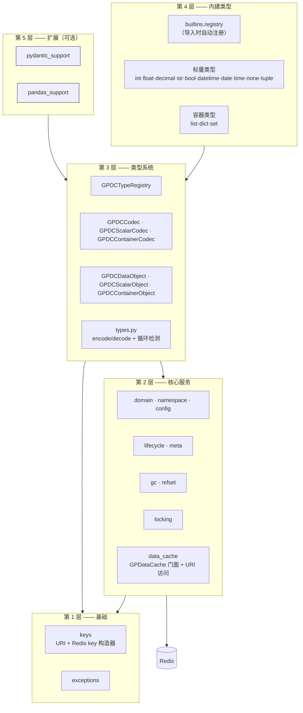
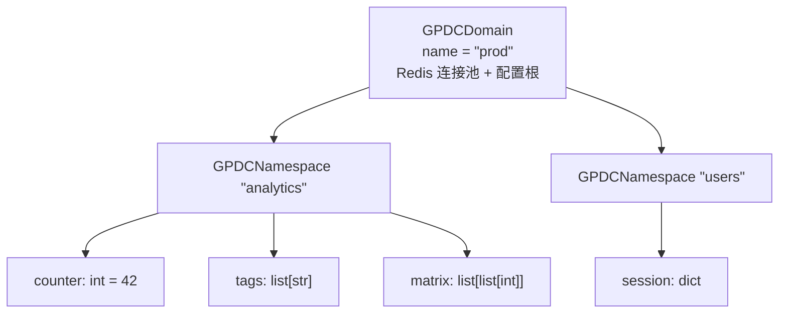
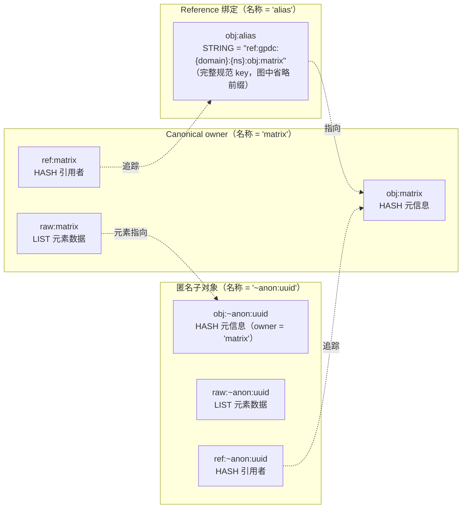
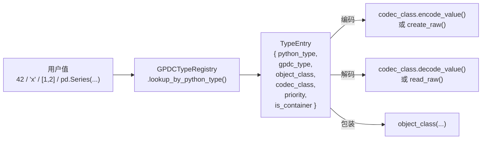

# 总体概览

本文阐述 `gpdatacached` **为什么**存在、是**如何**组织的，以及理解其架构所需掌握的**概念**。文中刻意不展开 API 用法 —— 相关内容请参阅 [API 参考](./api.md)。

## 1. 为什么需要 gpdatacached？

### 要解决的问题

**跨进程共享可变状态**很困难。

- `multiprocessing.Manager` 把每次访问都代理到单一服务进程 —— 既是瓶颈，也是单点故障。
- 直接使用 Redis 需要你手工（反）序列化所有数据。没有类型安全、没有引用追踪、没有 TTL 级联、没有跨进程锁。
- 内嵌缓存（functools、diskcache 等）都是进程内的：每个进程各持一份副本，没有共享真相。

### gpdatacached 提供了什么

`gpdatacached` 把 Redis 变成一个**共享的、带类型的、活跃的对象存储**，任何 Python 进程都能像使用本地 dict 一样使用它：

- 基于 Redis 的类 dict API，值是**带类型的**（`int`、`str`、`datetime`、`list`、`dict`、`set` …）。
- **活跃容器** —— `ns["tags"].append("x")` 直接修改 Redis，无需对整个结构做“读-改-写”竞态。
- **引用共享** —— 同一个容器可绑定到多个名称；数据仅存储一份。
- **逐对象生命周期** —— `permanent` / `ttl` / `sliding`（滑动窗口）缓存模式，支持级联传播。
- **后台 GC** —— 回收过期和成为孤儿的对象。
- **可选的分布式锁** —— 当确实存在竞争时，对多进程写入进行串行化。
- **基于 URI 的访问** —— 通过 [`GPDataCache`](./api.md#gpdatacache) 将 `gpdc://{domain}/{namespace}/{name}[/path]` 解析为数据对象，包括对匿名嵌套容器的遍历。

Redis 是唯一的数据真相来源。没有客户端缓存层，因此也不存在失效问题：每次读取都直达 Redis，看到的是最近一次已提交的写入。

---

## 2. 设计理念

六条原则塑造了整个库：

| # | 原则 | 后果 |
|---|---|---|
| 1 | **Redis 是真相来源** | 没有客户端缓存，没有失效问题。每次读取都是活跃的。 |
| 2 | **类 dict 的人机接口，带类型的底层支撑** | `ns["x"] = 42` 可用；但 `42` 会被类型检查、编码并连同元信息存储。 |
| 3 | **标量原生，容器活跃** | 标量读取返回 Python 值；容器读取返回活跃对象，让变更直接命中 Redis。 |
| 4 | **引用共享以 namespace 为界** | 禁止跨 namespace 引用，因此可以安全地批量删除 namespace。 |
| 5 | **生命周期与并发都是显式的** | 缓存模式位于每个对象之上；加锁可选，且永远不会自动触发。 |
| 6 | **以 Codec 驱动扩展** | 每种类型都是注册到全局注册表的一个 `(python_type, gpdc_type, object_class, codec_class)` 条目（外加一个可选的 `priority`）。 |

原则 **#3** 最具特色：正是它让本库用起来像本地数据结构，而非远程缓存。

```text
                ns["price"] = 42              ns["tags"] = ["a","b"]
                       │                              │
                       ▼                              ▼
        ┌────────────────────────┐     ┌────────────────────────────┐
        │   标量值编码后          │     │   活跃的容器对象            │
        │   存入 meta hash        │     │   存入 raw Redis list       │
        └────────────────────────┘     └────────────────────────────┘
                       │                              │
                       ▼                              ▼
         ns["price"] ──► 42            ns["tags"] ──► ListObject
         （原生 Python int）           （活跃代理：.append/.pop 直击 Redis）
```

---

## 3. 整体架构

`gpdatacached` 分为五层，每层**应当**只依赖其下方各层；`namespace`（第 2 层）是一个有据可查的例外 —— 它会向上触达第 3 层的类型注册表，因为在编码/解码时需要解析 codec。



| 层 | 职责 | 关键模块 |
|---|---|---|
| **基础层** | Redis key 构造器、URI 方案、异常。无状态。 | `keys`、`exceptions` |
| **核心服务层** | Domain/Namespace 门面、元信息模型、生命周期策略、GC、加锁、引用计数、多 domain 缓存 + URI 访问。 | `domain`、`namespace`、`config`、`meta`、`lifecycle`、`gc`、`locking`、`refset`、`data_cache` |
| **类型系统层** | 类型注册表、codec 抽象基类、对象抽象基类、元素编解码协议。 | `types`、`codec`、`object`、`scalar`、`container` |
| **内建类型层** | 具体的标量/容器类及其 codec，导入时自动注册。 | `builtins/*` |
| **扩展层** | 面向第三方库的可选类型族。 | `extensions/pydantic_support`、`extensions/pandas_support` |

第 5 层以下的所有内容都会在 `import gpdatacached` 时自动加载。扩展则需显式启用。

---

## 4. Domain → Namespace → Object 模型

GPDC 把数据组织为三层嵌套。每一层都是一个逻辑作用域；三者共同构成 GPDC **URI** `gpdc://{domain}/{namespace}/{name}`。URI 不仅仅是一个标识符 —— 它是一条可解析的访问路径。[`GPDataCache`](./api.md#gpdatacache) 会把 URI 解析为它所指向的数据对象，而可选的额外路径分段则用于深入嵌套容器内部（例如 `gpdc://prod/analytics/report/title` 等价于 `ns["report"]["title"]`）。



| 层级 | 角色 | 此处存放什么（示例） |
|---|---|---|
| **Domain** | 配置根 + Redis 连接池 + 锁/GC 默认值。以名称标识。 | `redis_host`、`default_cache_mode`、`gc_enabled`、`default_lock_ttl_seconds` |
| **Namespace** | Domain 内部的逻辑隔离空间，行为类似 `MutableMapping`。 | 对象名集合；namespace 级缓存默认值 |
| **Data Object** | 一个具名、带类型的值。要么是标量（单值），要么是容器（元素存放于独立的 raw key）。 | 元信息 hash（`type`、`value`、`cache_mode`、`ttl`、`owner` …）、可选的 raw 数据、可选的引用者集合 |

### 为什么是三层？

- **Domain** 是部署单元：一个 Redis 数据库、一组锁/GC 参数。多个进程打开同一个 domain 来共享数据。
- **Namespace** 是隔离单元：一个扁平的命名空间，可独立地清空、列举、删除。它也是**引用共享的边界** —— 见原则 #4。
- **Object** 是值单元：一段具有自身生命周期（以及可选的锁）的逻辑数据。

### 打开 domain：直接方式与托管方式

单个 domain 可通过 [`GPDCDomain`](./api.md#gpdcdomain) 直接打开（见[快速开始](./api.md#api-quick-start)）。当你的应用使用由 [gpconfig](https://github.com/linnetcodes/gpconfig) 配置文件驱动的多个 domain 时，[`GPDataCache`](./api.md#gpdatacache) 就是托管入口：它接收一个 `GPConfigFolder`，为每个配置惰性构造并缓存对应的 `GPDCDomain`，并将 GPDC URI 解析为数据对象。没有配置文件的 domain 无法通过 `GPDataCache` 创建 —— 这类情况请直接使用 `GPDCDomain`。

### 身份：canonical name 与 binding name

每个对象有两个名字：

- **binding name（绑定名）** —— 用户获取该对象时使用的 key。
- **canonical name（规范名）** —— 真正持有底层 Redis 数据的那个名字。

对于普通对象，两者一致。对于**引用（别名）**，两者不同，多个 binding name 可以指向同一个 canonical owner。详见 [§6](#6-ownerreference-anonymous)。

---

## 5. Redis Key 布局

每个 GPDC key 都以 `gpdc:` 前缀开头，并以可预测的方式把 domain/namespace/name 作用域编码其中。掌握这套布局后，你就可以直接用 `redis-cli` 检查或操作 GPDC 数据。

```text
gpdc:__meta__                                   全局元信息（协议版本）
gpdc:__domains__                                所有已注册 domain 名称的 SET

gpdc:{domain}:__meta__                          HASH —— domain 元信息
gpdc:{domain}:__namespaces__                    domain 下 namespace 名称的 SET

gpdc:{domain}:{ns}:__meta__                     HASH —— namespace 元信息

gpdc:{domain}:{ns}:obj:{name}                   对象 key：
                                                  ├─ HASH   → 元信息（canonical owner）
                                                  └─ STRING → "ref:{canonical_obj_key}"（别名绑定）

gpdc:{domain}:{ns}:raw:{name}                   容器原始数据：
                                                  ├─ LIST   （ListObject）
                                                  ├─ HASH   （DictObject / pydantic / DataFrame）
                                                  └─ SET    （SetObject）

gpdc:{domain}:{ns}:ref:{name}                   HASH —— referrer_name → ref_count

gpdc:{domain}:{ns}:lock:{name}                  STRING —— 分布式锁 token（SET NX EX）
gpdc:{domain}:{ns}:locknotify:{name}            LIST  —— 锁的 BLPOP 唤醒队列
```

**每个对象的三类 key 族。** 一个 canonical 容器对象最多持有三个 key —— `obj:`（元信息 hash）、`raw:`（元素数据）、`ref:`（引用者集合）。标量只持有 `obj:`。别名只持有一个存放 `ref:` 指针的 `obj:` 字符串。

**保留名。** 形如 `__xxx__` 的名称被保留（供上面的 meta key 使用），会被校验器拒绝。以 `~` 开头的名称是匿名对象（见 [§6](#6-ownerreference-anonymous)），对公开的映射 API 不可见。

---

## 6. 对象模型：Owner、Reference 与 Anonymous

这是 GPDC 的概念核心。同一套 key 空间中存在三种对象绑定：



### Canonical owner（规范所有者）

具名对象，**拥有**自己的原始数据。其 `obj:` key 是一个存放元信息的 HASH；若是容器，则还存在 `raw:` 与 `ref:` key。

### Reference（别名）绑定

当你执行 `ns["alias"] = ns["matrix"]` 时，GPDC **不会**拷贝数据。它会创建一个极小的 `obj:alias` STRING key，存放 `ref:{matrix 的 obj key}`，并把 matrix 的引用者计数加一。两个名称现在都解析到同一个 canonical owner。

- 读取会透明地跟随引用：`ns["alias"]` 与 `ns["matrix"]` 一样返回活跃容器。
- 锁会解析到 canonical name，因此 `ns.get_object("alias").lock()` 与 `ns.get_object("matrix").lock()` 在**同一个**锁上竞争。
- 删除别名只是移除绑定；canonical 数据会存活到其最后一个引用者消失为止。

### 匿名对象（Anonymous）

当你存储**嵌套容器** —— `ns["matrix"] = [[1, 2], [3, 4]]` —— 时，每个内层 list 都会被物化为一个匿名对象，名称形如 `~anon:{uuid}`。匿名对象：

- 通过其 `ref:` hash 中的**引用计数**追踪（每个引用者一项，值为槽位数）。
- 元信息中的 `owner` 设为创建它的父对象。
- 当最后一个引用者消失时（例如父对象被删除，或某个元素被覆盖/移除），会被**级联删除**。
- 对 `iter(ns)`、`len(ns)`、`in` 检查不可见。

### 提升匿名对象：`take_ownership()`

由于匿名对象的生命周期依附于其父容器（`owner = parent`），它没有独立的生命周期 —— 其 TTL 由 owner 链驱动（见[§5](./lifecycle.md#lifecycle-sliding)）。当你持有一个指向匿名对象的**命名引用**时，可以用 `take_ownership()` 把**被引用对象**提升为自持：

```python
ns["parent"] = {"inner": [1, 2, 3]}        # inner 是 ~anon:… ，owner 为 "parent"
ns["named"] = ns.get_object("parent")["inner"]
ns.get_object("named").take_ownership()    # 该 ~anon:… 现在拥有自己；"parent" 不受影响
```

此后匿名对象携带自己的策略（例如可以给它设独立于父对象的 TTL）。对**命名**（已自持）对象的引用，`take_ownership()` 是一个正确的 no-op。完整语义见[生命周期管理 §7](./lifecycle.md#7-the-ownership-model)。

### 为什么禁止跨 namespace 引用？

原则 #4：一个 namespace 是自洽的引用图。这让 `ns.clear()` 与 `domain.delete_namespace()` 可以批量（`SCAN + DELETE`）删除 namespace 下的所有 key，而无需逐对象走引用者清理逻辑。如果引用可以跨越 namespace 边界，批量删除就有孤立或破坏其他 namespace 数据的风险。

---

## 7. 编码与 Codec 系统

流入 GPDC 的每个 Python 值都会被某个 codec **编码**为字符串，并在读取时**解码**回来。存在两种编码风味。

### 标量编码：`type:payload`

标量值以内联形式编码为 `{type_prefix}:{payload}`：

```text
42            ──►  "int:42"
3.14          ──►  "float:3.14"
True          ──►  "bool:True"
"hello"       ──►  "str:hello"
datetime(...) ──►  "datetime:2026-06-21T10:00:00"
(1, 2, 3)     ──►  "tuple:[\"int:1\",\"int:2\",\"int:3\"]"
```

存储的元信息 `value` 字段直接持有该字符串。无需独立的 raw key。

### 容器元素编码：`ref:obj_key`

当容器被逐元素编码时，每个元素要么是：

- 一个标量编码值（`int:42`、`str:hello` …），内联存储于容器的原始数据中；**或者**
- 一个 `ref:{obj_key}` 指针，指向某个嵌套容器 —— 该容器已被物化为一个独立的（可能是匿名的）对象。

嵌套就是这样实现的：外层容器的 raw key 持有指针；内层容器作为独立的 GPDC 对象存在，并由引用计数追踪。

### 类型注册表



每种类型都注册为一个 `TypeEntry` 元组。两个方向都可查找：按 Python 类型（编码时）与按 GPDC 类型字符串（解码时）。歧义情形（如 `bool` 与 `int`）由 `priority` 决定。

### 编码会话（encode_session）：循环检测 + 原子回滚

一次顶层编码可能产生许多兄弟操作（例如存储一个 list 的 list）。GPDC 把它们包裹在 **`encode_session`** 上下文中，该上下文会：

1. 维护一份 `id(value) → state` 的备忘录，用于检测**循环**（抛出 `CyclicReferenceError`）。
2. 把对**同一个**容器的重复引用别名为同一对象，而非重复存储。
3. 出现异常时，**回滚**本次会话期间创建的所有匿名对象，并逆转其对既有容器所做的引用计数增量，使失败的编码不留下编码路径的写入残留。（对于首次存储，`namespace.__setitem__` 还会删除刚写入的绑定的 `obj:`/`raw:`/`ref:` key，因此一次失败的 `ns[name] = value` 不会留下任何孤儿元信息。）

---

## 8. 生命周期与垃圾回收

> 本节是架构层面的简要概述。完整的生命周期模型 —— 策略来源、滑动刷新机制、所有权、匿名/引用对象的生命周期，以及常见陷阱清单 —— 见专门的[生命周期管理](./lifecycle.md)文档。

### 三种缓存模式

每个对象在其元信息中携带一份 `(cache_mode, ttl)` 策略。

| `cache_mode` | TTL | 语义 |
|---|---|---|
| `permanent` | `0` | 永不过期。会调用 Redis `PERSIST`。默认。 |
| `ttl` | `> 0` | 固定过期：对象在 `ttl` 秒后过期一次。 |
| `sliding` | `> 0` | 滑动窗口：每次变更都把 TTL 重置为 `ttl` 秒。 |

### 级联传播

容器的生命周期会**传播**到它所拥有的匿名子对象子树：

- 一次策略变更（`update_cache_mode_and_ttl`、`persist`、`expire_in` …）会在一次流水线中重写整个所属子树的元信息并重新应用 TTL。
- 一次 `sliding` 模式变更会沿 owner 链向上刷新 TTL，使得任一后代被触碰时祖先的窗口也会重置。

### 垃圾回收

两类情况会产生需要 GPDC 清理的孤儿：

1. **TTL 过期** —— 当 `ttl`/`sliding` 对象的 Redis TTL 触发，它会消失，但其引用者（以及引用者的引用者集合）可能仍然存在。
2. **引用抖动** —— 覆盖/移除容器元素会留下过期的 `ref:` 条目。

当 `gc_enabled=True` 时，后台线程会按 `gc_interval_seconds` 的周期，为每个 namespace 运行 `run_gc_for_namespace`。GC 会：

1. `SCAN` 三类 key 族（`obj:`、`raw:`、`ref:`），并按 canonical name 分组。
2. 对每个 canonical name，获取该对象的锁（带较短的超时 `gc_lock_wait_seconds` —— 竞争时跳过）。
3. 修复三类问题：目标已消失的过期别名绑定、没有存活引用者的 raw key、以及引用者实际已不再指向目标的 ref-set 条目。

你也可以用 `domain.run_gc(namespace=None)` 手动触发 GC。

---

## 9. 并发模型

### 默认是可选加锁

GPDC 面向**单写入者或低竞争**场景设计。每条 Redis 命令本身是原子的，因此大多数工作负载并不需要加锁。当你确实有多个写入者在同一对象上竞争时，可以通过 `obj.lock()` 主动加锁：

```python
with ns.get_object("counter").lock():
    current = ns["counter"]
    ns["counter"] = current + 1
```

加锁**永远不会自动触发** —— 变更方法不会替你获取锁。

### 锁的范围

`obj.lock()` 加锁的是对象的 **canonical name**。引用与其 canonical owner 解析到同一把锁，因此两个进程即便持有同一份数据的不同别名，仍会正确串行化。锁是建议性的，且每次操作都会产生 Redis 开销 —— 完整设计（含性能影响与推荐用法）详见[多进程加锁](./locking.md)。

### 锁的实现

每把锁是一个用 `SET NX EX`（token 作用域）设置的 Redis key，外加一个 `BLPOP` 唤醒队列，让等待者高效阻塞而非轮询。释放是一段 Lua 脚本，会校验 token、删除锁，并原子地唤醒一个等待者。

### GC 与写入者的契约

这里有一条硬性规则：

> **若 `gc_enabled=True`，每个并发写入者都必须使用 `obj.lock()`。**

GC 在处理每个 canonical name 时会获取同一把对象级锁。绕过加锁的写入者可能与 GC 竞态并破坏状态。（启用 GC 的单写入者场景没问题 —— 没有竞争。）完整契约及其带来的代价详见[多进程加锁](./locking.md)。

---

## 10. 可扩展性

> 本节是架构层面的简要概述。完整的类型系统讲解与实战示例（自定义标量 `Color`、自定义容器 `Counter`、优先级规则、codec 契约、变更钩子），见专门的[可扩展性](./extensibility.md)文档。

### 注册自定义类型

任何你能编码的东西都能存储。注册模式固定如下：

1. 编写一个 `GPDCScalarCodec`（单值）或 `GPDCContainerCodec`（带元素的 raw key）的子类。
2. 编写一个 `GPDCScalarObject` 或 `GPDCContainerObject` 的子类，给出唯一的 `TYPE`。
3. 用 `GPDCTypeRegistry.register(...)` 注册一个 `(python_type, gpdc_type, object_class, codec_class)` 条目（外加一个可选的 `priority`）。

此后，`ns["x"] = MyValue()` 与内建类型完全一致 —— 包括嵌套引用、生命周期与加锁。

### 内建扩展

库自带两个可选扩展，完全遵循上述模式：

| 扩展 | 新增能力 | 适用场景 |
|---|---|---|
| [`pydantic_support`](./pydantic-support.md) | 可缓存的 pydantic `BaseModel` 记录（标量或容器模式） | 你需要带字段级访问、嵌套容器字段的类型化记录。 |
| [`pandas_support`](./pandas-support.md) | 可缓存的 pandas `Series` 与 `DataFrame` | 一个写入者缓存大型数据集；多个读取者各自拉取子集在本地操作。 |

两者都能与 GPDC 的其余部分组合 —— 通过扩展注册的类型，既可以作为 `DictObject` 中的值、`ListObject` 中的元素，也可以作为容器模式 pydantic 模型的字段。

---

## 延伸阅读

- **[API 参考](./api.md)** —— 完整的公共 API 参考。
- **[性能指南](./performance-guide.md)** —— 会拖累性能的用法及其推荐替代（滥用 sliding TTL、过深嵌套、不必要地启用 GC/加锁）。把 GPDC 放上热路径前必读。
- **[可扩展性](./extensibility.md)** —— 类型系统详解，含添加自定义标量与容器类型的完整示例。
- **[生命周期管理](./lifecycle.md)** —— 完整的生命周期模型：策略来源、滑动刷新、所有权、匿名与引用对象、常见陷阱。
- **[多进程加锁](./locking.md)** —— 何时需要加锁、性能影响、推荐用法、避免死锁、与 GC 的交互。
- **[Pydantic 支持](./pydantic-support.md)** —— 缓存 pydantic `BaseModel` 记录。
- **[Pandas 支持](./pandas-support.md)** —— 缓存 pandas `Series` / `DataFrame`。
