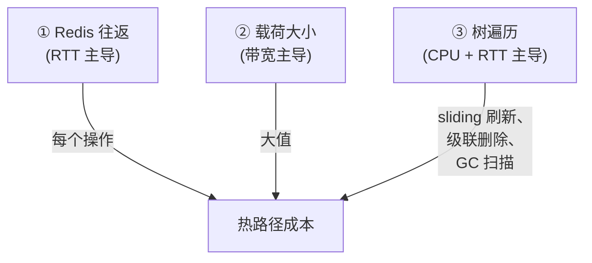
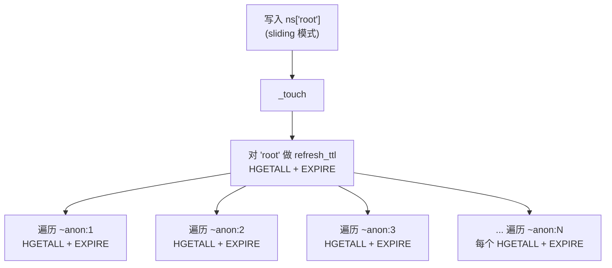

# 性能指南

本指南列举**会严重拖累** `gpdatacached` 性能的使用方式，解释每一种为何昂贵，并给出推荐的替代做法。在把 GPDC 放上热路径之前，请先通读一遍。

这些陷阱大多不是 bug，而是 GPDC *能够*执行、但你应有意识地、而非默认地去使用的操作的固有代价。

## 1. 成本模型

三件事主导 GPDC 的性能。把它们内化，本指南的其余部分便自然成立。



1. **Redis 往返（RTT）。** 每个 GPDC 操作都是一次或多次 Redis 往返。局域网下每次约 0.2–2 ms；广域网下可能 10–100 ms。小操作是**时延受限**，而非吞吐受限。
2. **载荷大小。** 大值（大字符串、大 list）消耗带宽与 Redis 的（反）序列化 CPU 时间。无论 RTT 多小，每次写入都重新编码 10 MB 结构都很昂贵。
3. **树遍历。** 若干 GPDC 操作会遍历对象子树：sliding TTL 刷新、生命周期级联传播、级联删除、GC。其开销与**所属子树大小**成正比，且每一步通常伴随一次 Redis 往返。

下文的反模式归根结底都是**不必要地频繁触发这些代价，或在过大的子树上触发**。

---

## 2. 每操作成本参考 { #perf-cost-ref }

速查表。“RTT” = Redis 往返。N = 元素数；次数为近似值，未计竞争。必要时以“本地”标注不访问 Redis 的工作。

| 操作 | 成本量级 | 说明（已对照源码核实） |
|---|---|---|
| `ns[k] = scalar` | O(1)，新建约 5 RTT / 覆盖约 4 RTT | `TYPE`（解析）+ `HGET` ×2（namespace 默认策略）+ `HSET`（元信息）+ 一次 TTL 应用（`PERSIST`/`EXPIRE`）。覆盖会复用现有策略（无需读 namespace 默认值），转而在解析阶段重读旧 meta（`HGETALL`）。 |
| `ns[k]`（标量读） | O(1)，约 3 RTT | `_resolve_binding`（`TYPE` + `HGETALL`）**再加**标量 `.value` getter 重新加载 meta（`HGETALL`）。 |
| `ns[k] = [a, b, c]`（扁平、元素为标量的容器） | O(N) 本地编码，数据写入 **O(1)** RTT | 一次 `encode_session` + 一次批量 `create_raw`（单条 `RPUSH`/`HSET`/`SADD` 携带全部元素）+ `HGET` ×2（namespace 默认策略）+ 元信息 `HSET` + 对 obj/raw/ref key 的 TTL 应用（共约 8 RTT，与 N 无关，对标量元素成立）。 |
| `ns[k] = [[...], ...]`（嵌套容器） | O(**嵌套容器数量**) RTT + O(N) 本地 | 每个嵌套容器成为一个匿名对象（meta `HSET` + 自身 `create_raw` + `HINCRBY` 引用 + TTL 应用，每个约 5–6 RTT）。**深度不乘** —— 决定规模的是总节点数。 |
| `container.append(x)` / `container[k] = v`（标量元素、非 sliding） | O(1)，约 5–6 RTT | `HGETALL`（取策略）+ 数据写入（`RPUSH`/`HSET`）+ `_touch`（`LLEN`/`HLEN` + `HGETALL` + `HSET`）。**若 `cache_mode="sliding"` 再加子树遍历**（§3）；**若元素本身是容器，再加约 5–6 RTT**（创建匿名对象）。 |
| `iter(ns)` / `len(ns)` | O(N)，批量 SCAN | 每 ~100 个 key 一页若干 RTT（`len` 委托给 `iter`）。不要放进热循环。 |
| `k in ns` | O(1)，1–4 RTT | 直接对该具名 key 做 `TYPE` + `HGETALL`（owner 绑定 1–2 RTT）；引用会再加一次 `GET` + 另一次 `TYPE`（别名最多 4 RTT）。**不是** SCAN。不随 namespace 大小而增长。 |
| `del ns[k]`（容器 owner） | O(所属子树大小) | `_teardown_owner_container` 释放每个嵌套引用（`HDEL`）并级联删除成为孤儿的匿名子对象；每节点约 1+ RTT。若仍存在活跃的别名引用者则抛 `CanonicalObjectReferencedError` —— 先删别名。 |
| `ns[k] = new_container`（覆盖） | O(旧 + 新子树大小) | 旧的完整拆解 + 新的完整编码 —— 见 [§8](#8-vs)。 |
| `obj.lock()` + 释放（无竞争） | +2 RTT | `SET NX EX` + 一段 Lua 释放脚本。 |
| 变更触发的 sliding 刷新 | O(所属子树大小) | 每个所属子对象：`HGETALL` + TTL 重应用。见 [§3](#3-sliding-ttl)。 |
| `obj.persist()` / `update_cache_mode_and_ttl(...)` | O(所属子树大小) | 跨子树重写元信息（`HSET`）+ 重新应用 TTL，每层级一条流水线。 |
| `domain.run_gc()` | O(N 个 canonical name) | 三类 `SCAN` + 每对象加锁 + 类型/存在性检查。见 [§5](#5-gc)。 |
| `.value`（完整容器读取） | 扁平：1 RTT + O(N) 本地；嵌套：+O(嵌套数) RTT | 一次批量读（`LRANGE`/`HGETALL`/`SMEMBERS`）；每个 `ref:` 元素再加一次 `HGETALL` + 解码其匿名对象。 |
| `name in cache`（`GPDataCache`） | **本地，0 RTT** | 纯配置快照检查，通过 `folder.list_configs()` 实现。不触碰 Redis，也不会构造 domain。是本库中最便宜的成员测试。 |
| `cache.get_domain(name)` | 首次调用：domain 构造（读/校验 domain meta）；后续：**0 RTT** | 首次访问时经由 gpconfig 的工厂构造并缓存 `GPDCDomain`；之后的调用返回已缓存实例。不会重新读取配置文件。 |
| `cache.get_object_by_uri(uri)` | 根：约 4–5 RTT；**每条路径分段 +1 RTT** | `get_namespace`（`SISMEMBER` + namespace-meta `HGETALL`，约 2 RTT）+ 根对象解析（`TYPE` + `HGETALL`，约 2–3 RTT）。每条额外路径分段是一次 `__getitem__` 读取（`ListObject` 用 `LINDEX`，`DictObject` 用 `HGET`）。`cache.has_uri(uri)` 成本相同（它用 try/except 调用 `get_object_by_uri`）。domain 仅在首次访问时构造；同一 domain 之后的 URI 会复用已缓存的 domain。 |

---

## 3. 滥用 sliding TTL

`cache_mode="sliding"` 在每次变更时刷新 TTL。**刷新会遍历整个所属子树。** 这是 GPDC 中最常被忽视的性能代价。

### 为何昂贵

当一个自持的 sliding 容器被变更时，GPDC 会调用 `refresh_ttl()`，它会：

1. 给对象自身的 key 重新应用 `EXPIRE`/`PERSIST`（此前先 `HGETALL` 加载自身 meta）。
2. 递归下钻每个**所属子对象**：每个子对象都做一次 `HGETALL`（读取该子对象自身的策略），并把其 TTL 重新应用到它的 key。
3. 直到整棵所属子树都被遍历完才返回。

因此，对一个拥有 1000 个匿名子对象的 sliding list 做一次 `append`，代价是**数千次** Redis 往返 —— 每个所属子对象一次 `HGETALL` + TTL 重应用（每一步都是一次单独的往返；这条路径并未流水线化，不像 `persist()`/`update_cache_mode_and_ttl()` 那样按子树层级批量成一条流水线）。在频繁写入的循环里，这会把你的表观写入代价放大到子树大小倍。



### 推荐

- **默认用 `permanent` 或 `ttl`。** 它们在写入时永不触发子树遍历。`ttl` 过期一次就结束，没有每次变更的代价。
- **有节制地使用 `sliding`。** 留给那些确实需要“被触碰时保持存活”语义的特定对象 —— 通常是少量会话类或热缓存对象。
- **让 sliding 对象保持扁平。** 由于刷新开销是 O(所属子树大小)，拥有深嵌套匿名子对象的 sliding 容器是最坏情形。必须用 sliding 时，优先选扁平结构。
- **避免在高抖动容器上用 `sliding`**（频繁 append/pop）。每次变更都要付出完整子树遍历的代价。

> 完整机制 —— owner 链、向上 vs 向下传播、校验规则 —— 见[生命周期管理](./lifecycle.md#lifecycle-sliding)。

---

## 4. 过深的容器嵌套 { #perf-nesting }

GPDC 支持任意深度的容器嵌套（`ns["x"] = [[[[1]]]]` 可行）。但每层嵌套都有实在的代价。

### 嵌套的代价

每个嵌套容器都会被物化为一个**独立的匿名对象**，拥有自己的 `obj:` / `raw:` / `ref:` key，按引用计数并链接到 owner。存储 `[[[1, 2], [3, 4]], [[5, 6]]]` 会创建 5 个匿名对象（每个内层 list 一个），每个都需要：

- 一次 `encode_element` 调用，向父对象的原始数据写入一个 `ref:` 指针。
- 一次元信息 hash 写入（`HSET`）。
- 一次 raw key 写入。
- 一次引用者集合自增（`HINCRBY`）。
- 一次 TTL 应用（`EXPIRE` / `PERSIST`）。

**读取**时，`.value` 会加载每个匿名子对象的元信息（每个 `ref:` 元素一次 `HGETALL`）并返回一个活跃的 `GPDCContainerObject` 句柄 —— 它**不会**递归解码嵌套数据。若你需要完整解码的 Python 结构，请使用 `.deepcopy()`（它会递归物化每一层）。

**变更**时，sliding 刷新与级联删除的开销都与子树大小成正比（见 [§3](#3-sliding-ttl) 与 [§10](#perf-ref-churn)）。

### 推荐

- **保持嵌套浅。** 一两层通常没问题。再深就要重新审视数据模型。
- **当嵌套表示并非语义必需时，优先用扁平结构。** 一个扁平的标量元组 list 往往能用一层而非三层表达同样的数据。
- **把大型子结构存为具名对象**并按名称引用，而不是把它们作为匿名子对象嵌套。具名对象可独立更新（不会触发父对象的子树遍历），更便宜。
- **对于表格型数据，用 `DataFrameObject`**（见 [Pandas 支持](./pandas-support.md)），而非 list-of-lists —— 它按列存储，选择性读取时便宜得多。

> 嵌套通过 encode/decode 元素协议实现；见[可扩展性 §10](./extensibility.md#10-vs)。

---

## 5. 不必要地启用 GC

`gc_enabled=True` 会启动一个后台 GC 线程。GC 是针对 TTL 过期与引用抖动所产生的孤儿 key 的**安全网** —— 对于不产生孤儿的工作负载，它并非正确性所必需。

### 启用 GC 为何昂贵

两层代价：

1. **GC 周期本身。** 每次 `run_gc_for_namespace` 做三类 `SCAN`（`obj:` / `raw:` / `ref:`）—— O(N)，N 为 canonical name 数 —— 且对每个 canonical name 获取对象级锁并跑若干类型/存在性检查。在百万级对象的 namespace 上，这相当可观。
2. **强制加锁契约。** 这才是更大的代价。当 `gc_enabled=True` 时，**每个写入者都必须使用 `obj.lock()`** —— 包括同一进程内与你自己的写入线程竞态的 GC 线程。这意味着每个竞争对象上的每次变更 **+2 RTT**，外加锁串行化。见 [§6](#perf-lock-misuse) 与[多进程加锁](./locking.md)。

### 推荐

- **默认关闭 GC。** `GPDCDomainConfig(gc_enabled=False)` 作为默认值是有原因的。
- **仅当你确实产生孤儿时才启用 GC** —— 也就是当你使用会过期并留下引用者条目的 `ttl` 或 `sliding` 对象，或在匿名子对象上有高引用抖动时。只存 `permanent` 对象且很少删除的工作负载几乎不产生孤儿；GC 对你毫无收益，却要付出加锁开销。
- **孤儿量不大时，在维护窗口手动跑 GC**：`domain.run_gc(namespace=None)` 返回被删除的 key 数。这既避免了后台线程，也免除了常驻的加锁契约。
- **若确实启用 GC，就接受加锁代价**，并在所有写入者预算每变更 +2 RTT。完整契约见[多进程加锁](./locking.md)。

> GC 清理什么、何时运行，见[生命周期管理 §10](./lifecycle.md#lifecycle-gc)。

---

## 6. 锁的误用 { #perf-lock-misuse }

锁是**可选且建议性的**，且并非免费。完整分析见[多进程加锁 → 性能影响](./locking.md#locking-perf)；简版如下：

- 无竞争的 `obj.lock()` 给每个操作加 **+2 RTT**（获取 + 释放）。
- 有竞争的锁会串行化访问：吞吐降到 `1 / (关键区 + 2·RTT)`。
- **`gc_enabled=True` 会强制每次变更都加锁**（见 [§5](#5-gc)）。

### 反模式

- **投机性加锁。** 在没有测量到竞争时“以防万一”地加 `obj.lock()`，会让你的 RTT 开销成倍增加却毫无收益。GPDC 的每命令操作本身就是原子的。
- **在热循环里加锁。** N 次迭代 × +2 RTT 会盖过真正的工作。要么把锁提到循环外整体包住，要么通过 `.value` 把数据拉到本地处理。
- **持锁期间做 I/O 或重计算。** 这会让所有其他等待者排在你无关的工作后面。
- **锁的与变更的不是同一对象。** 锁以 canonical name 为 key；锁住 `obj_A` 不会保护对 `obj_B` 的写入。

### 推荐

- **默认不加锁。** 针对**测量到的**某个具体对象的竞争，被动加锁。
- **关键区保持最小** —— 读 → 计算 → 写，仅此而已。
- **投机路径优先 `try_lock()`**，可推迟时即推迟。

> 完整经验法则与开销表见[多进程加锁 → 推荐用法](./locking.md#locking-recommended)。

---

## 7. 往返次数反模式

由于每个操作都是一次或多次 Redis 往返，毁掉性能最稳妥的方式就是在循环里发出大量往返。

### 反模式：逐元素循环

```python
# 糟糕：N 次读往返 + N 次写往返
total = 0
for i in range(len(ns["scores"])):
    total += ns["scores"][i]
```

```python
# 良好：一次往返物化，在本地处理
scores = ns["scores"].value        # 一次读
total = sum(scores)
```

```python
# 良好：一次变更调用，而非 N 次
ns["scores"].extend(new_values)    # 一条流水线，而非 N 次 append
```

### 反模式：对整个结构读-改-写

```python
# 糟糕：为了改一个单元格，解码 + 重新编码整个 list
data = ns["matrix"].value
data[0][0] = 99
ns["matrix"] = data                # 完整拆解 + 重建（见 §8）
```

```python
# 良好：就地改一个单元格
ns["matrix"][0][0] = 99            # 一次定向写入
```

### 推荐

- **使用容器的变更方法**（`append`、`extend`、`__setitem__`、`pop` …）—— 它们在元素级别直接命中 Redis。
- **需要对同一份数据做多次操作时，先用 `.value` 拉到本地一次**，然后一次性写回结果。
- **用 `extend(...)` 批量追加**，而非多次 `append(...)`。
- **对 pandas**，见 [Pandas 支持 → 访问器成本指南](./pandas-support.md#pandas-cost-guide)：一次性子集读取用在线选择性访问器；重度重复操作用 `.value`。永远不要按行或按单元格访问缓存。

---

## 8. 容器整体覆盖 vs 就地变更

覆盖容器绑定（`ns[k] = new_container`）比就地变更**昂贵得多**。

### 原因

对已存在的容器绑定执行 `ns[k] = new_value`：

1. 解析已存在的绑定。
2. 检查引用者（若存在则抛 `CanonicalObjectReferencedError`）。
3. **拆解**旧容器：扫描其原始数据中的嵌套引用，释放每个嵌套匿名子对象的引用者，删除 raw key 与 ref key。
4. **从零重建**：一次完整的 `encode_session` + `create_raw`，产生一组全新的匿名子对象。
5. 把策略重置为 namespace 默认值（不保留前一份策略）。

总开销为 **O(旧子树大小 + 新子树大小)**。对大 list 而言，这就是每次写入都全量重新编码。

### 推荐

- **通过容器的方法就地变更**（`append`、`__setitem__`、`extend` …）。每个元素 O(1)（外加 `_touch()`）。
- **避免在热路径上 `ns[k] = 整个新结构`**。
- **确实需要全量重写时**，接受这份代价但心中有数。若你对一个大结构频繁这么做，重新考虑数据模型。

---

## 9. 枚举的开销

`iter(ns)` 与 `len(ns)` 是 **基于 SCAN** 的，开销是 O(N)，N 为 namespace 中的具名对象数。它们会被批量流水线化（每个 SCAN 页一条流水线），但仍线性增长。（`len(ns)` 委托给 `iter(ns)`。）

> 注意：`k in ns` **不属于**这一类 —— 它直接解析该具名 key（`TYPE` + `HGETALL`，或对引用做 `GET` + `TYPE` + `HGETALL`）。它是 O(1)，每次检查 1–4 RTT，与 namespace 大小无关。只有在紧凑循环里、连 1–4 RTT 的累积都成问题时，才值得替换。

### 反模式

```python
# 糟糕：每次迭代 O(N) 扫描
for name in ns:                    # SCAN
    if name.startswith("user."):   # 对象名只允许字母/数字/'.'/'_'
        process(ns[name])
```

### 推荐

- **不要把 `iter(ns)` / `len(ns)` 放进热循环。** 需要多次使用时，把结果缓存起来。
- **高频成员测试，也不要把 `k in ns` 放进紧凑循环** —— 每次检查仍是一次 Redis 往返。要么自维护一份索引（一个 `SetObject` 存合法名称），要么直接读并捕获 `KeyError`。
- **`cache.has_uri(uri)` / `cache.get_object_by_uri(uri)` 同样并非免费** —— 每次都要一次 Redis 往返（外加每条路径分段一次；见 [§2](#perf-cost-ref)）。对同一组 URI 做紧凑的存在性检查循环时，应把结果缓存到本地，而非每次迭代都重新解析。（相比之下，`name in cache` 是一次本地 0-RTT 的配置检查。）
- **namespace 级清理优先用 `ns.clear()`**（一次批量 SCAN+DELETE），而非反复 `del ns[k]`。

---

## 10. 引用抖动 { #perf-ref-churn }

持有**嵌套匿名子对象**的容器，每次结构变更都要付出代价：移除或覆盖一个元素会释放一个引用；当某个匿名子对象的最后一个引用者消失时，它会被级联删除（而这又会遍历*它的*子对象）。在这类结构上高抖动会产生源源不断的引用追踪流量与级联删除。

### 反模式

```python
# 一个工作项队列，每项是嵌套 dict，吞吐很高
ns["queue"] = []                       # list of dicts
while True:
    item = make_item()                 # 一个 dict
    ns["queue"].append(item)           # 每次 append 创建一个匿名对象
    ...
    ns["queue"].pop(0)                 # 释放一个匿名对象，级联删除它
```

每个 `append` + `pop` 循环都会创建并随即级联删除一个匿名对象 —— 每项多次往返的簿记。

### 推荐

- **高抖动数据用扁平的、元素为标量的容器。** 一个标量 list、或元组 list、或编码字符串 list —— 每个元素不再产生匿名对象。
- **队列/日志把条目存为标量**（如 JSON 编码字符串，或元组），而非嵌套容器。你会失去就地的嵌套变更，但换来 O(1) 的抖动。
- **若你需要嵌套结构且读抖动高、写抖动低**，嵌套没问题 —— 代价在写入/删除路径上。

---

## 11. 网络拓扑

由于小操作由 RTT 主导，Redis 部署在哪里与你如何使用它同样重要。

### 推荐

- **让 GPDC 客户端与 Redis 同处一地。** 同主机或同数据中心；亚毫秒级 RTT 是设计目标。
- **不要跨广域网区域共享同一个 GPDC domain。** 跨区域 RTT（10–100 ms）会让每个操作都显得慢。
- **连接池已由 `GPDCDomain` 处理** —— 它会打开一个 `redis.ConnectionPool` 并复用。你无需自行管理连接。
- **若确需跨区域共享**，考虑每个区域一个 Redis + 应用层复制，而非把一个 GPDC domain 拉伸跨区域。

---

## 12. 该做 / 不该做 速查

| ✅ 该做 | ❌ 不该做 |
|---|---|
| 默认用 `permanent` / `ttl` 缓存模式 | 默认把 `sliding` 放在大或高抖动容器上 |
| 只在小型、特定的“保活”对象上用 `sliding` | 全量铺开 sliding |
| 保持容器嵌套浅（1–2 层） | 在热路径上存深嵌套结构（`[[[...]]]`） |
| 把大型子结构存为具名对象 | 把一切都作为匿名子对象嵌套 |
| 默认 `gc_enabled=False` | 在没有 `ttl`/`sliding` 对象时“以防万一”开 GC |
| 在维护窗口手动 `domain.run_gc()` | 在纯 permanent 工作负载上常驻后台 GC |
| 仅在测量到竞争时加锁 | 投机性加锁，或在热循环里加锁 |
| 使用容器的变更方法（`append`、`__setitem__`、`extend`） | 通过 `ns[k] = ...` 对整个结构读-改-写 |
| 重度重复操作时用 `.value` 拉到本地 | 在循环里逐元素访问缓存 |
| 与 Redis 同处一地 | 把一个 domain 拉伸跨广域网 |
| 高频查找自维护索引 | 把 `iter(ns)` / `k in ns` 放进热循环 |
| 高吞吐队列用扁平的标量元素容器 | 高吞吐队列用“每元素一个嵌套容器” |

---

## 延伸阅读

- **[多进程加锁 → 性能影响](./locking.md#locking-perf)** —— 锁开销模型的详解。
- **[生命周期管理 → 滑动窗口刷新](./lifecycle.md#lifecycle-sliding)** —— sliding 刷新为何会遍历子树。
- **[生命周期管理 → 垃圾回收](./lifecycle.md#lifecycle-gc)** —— GC 每个周期实际做什么。
- **[Pandas 支持 → 访问器成本指南](./pandas-support.md#pandas-cost-guide)** —— 选择性读取 vs 完整还原的开销。
